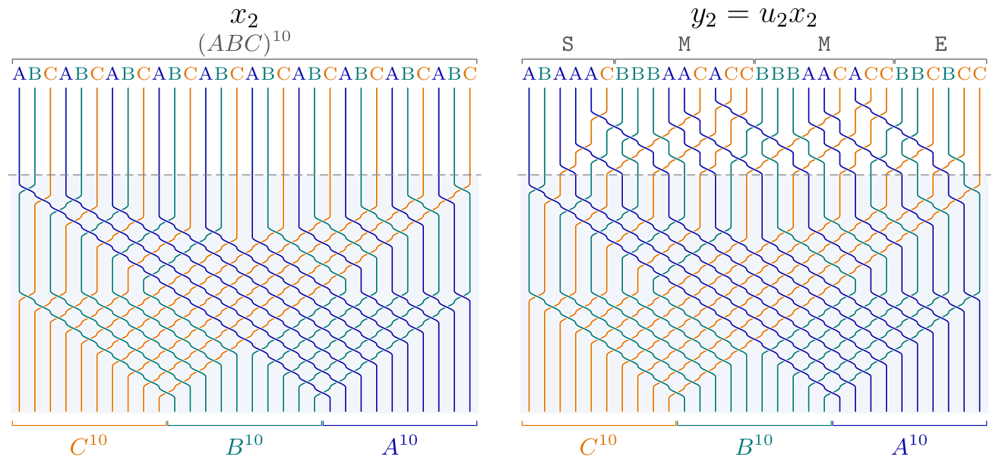
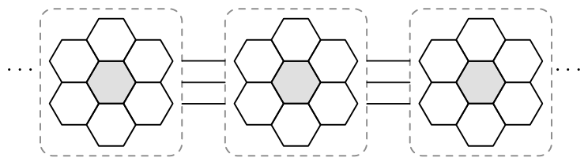

# 1. Introduction

[Section index](README.md) · [Complete paper](../paper.md) · [AI reading guide](../../AI_README.md)

We prove that $\mu$-coefficients for
$S_n=\operatorname{Aut}(\{1,\ldots,n\})$ grow at least
exponentially in $n$. By standard parabolic embeddings, this settles the boundedness question in all classical finite types and gives the same growth in their affine counterparts.

### 1A. The question

Kazhdan–Lusztig (KL) polynomials \[[KL79](references.md#bib-KL)\] sit at the meeting point
of the representation theory of Hecke algebras, combinatorics and
the geometry of Schubert varieties. Among their coefficients,
the $\mu$-coefficients play a distinguished role. They are the
coefficients in the highest degree permitted by the KL degree
bound, taken to be zero when this bound is not attained.

**Remark 1A.1.** There are plenty of applications, and we can only give a biased list.
For a fixed Coxeter system, the full collection of $\mu$-coefficients determines all KL polynomials recursively,
and the $\mu$-coefficients determine the action of simple reflections on the KL basis and 
give the edge weights in the KL cell
$W$-graphs \[[KL79](references.md#bib-KL)\]. Together with descent data, these weights
determine the cell representations, which in type $A$ give all
simple complex representations of symmetric groups.
For finite Weyl groups, they also determine composition
multiplicities of Verma modules in regular integral blocks of
category $\mathcal O$, via the KL character formula \[[KL79](references.md#bib-KL)\].
For Weyl groups, $\mu(x,y)$ gives a local intersection cohomology
dimension of a Schubert variety in degree $\ell(y)-\ell(x)-1$
\[[KL80](references.md#bib-KLPositivity)\].
The combinatorial invariance conjecture, due independently to
Lusztig and Dyer \[[Dye87](references.md#bib-Dyer)\], predicts, in particular, that
$\mu(x,y)$ is an invariant of the abstract Bruhat interval $[x,y]$.
(A proof with Lean verification was recently claimed in
\[[OAI26](references.md#bib-OpenAICIC)\].)
These examples are just the tip of the iceberg.

The $\mu$-coefficients are nonnegative integers \[[KL80](references.md#bib-KLPositivity)\].
For a long time, they were conjectured to take only the values
$0$ and $1$, see e.g. \[[LS81](references.md#bib-LS), [GM88](references.md#bib-GarsiaMcLarnan)\]. McLarnan and Warrington disproved this conjecture
in 2002 \[[MW03](references.md#bib-MW)\], and subsequent computations produced
considerably larger examples \[[War11](references.md#bib-Warrington)\].
This left a natural question that remained open for more
than two decades: Are the $\mu$-coefficients bounded? If not, how quickly can they grow?

**Remark 1A.2.** The question is different from asking whether the coefficients
of KL polynomials can be arbitrarily large. Indeed, Polo
showed that every polynomial with nonnegative integer
coefficients and constant term $1$ occurs as a KL polynomial
of some symmetric group \[[Pol99](references.md#bib-Polo99)\]. However, the
$\mu$-coefficient must occur in the highest degree permitted
by the KL degree bound, and Polo's construction does not
ensure this.

Scott–Xi constructed examples with $\mu=n+2$ in affine type
$\widetilde A_n$ for $n\ge4$ \[[SX10](references.md#bib-SX)\], proving
unboundedness as the rank varies.
Lübeck's computations \[[Lüb20](references.md#bib-Luebeck)\] suggested exponential growth
with the rank for first cohomology dimensions; see also
\[[PS14](references.md#bib-ParkerStewart)\] for upper bounds.
For finite symmetric groups, even unboundedness remained open.
Our explicit family settles this question with a much stronger
conclusion (cf. [Corollary 8C.1](08.md#thm:rankbound)):

**The $\mu$-coefficients of symmetric groups grow at least
exponentially in the rank, already within left cells of
three-row rectangular shape.**

This is a dramatic jump in complexity compared with many known
results and examples.
Several natural classes of pairs in finite and affine types
satisfy $0$-$1$ bounds \[[Gre09](references.md#bib-Green), [Jon09](references.md#bib-Jones), [Xi05](references.md#bib-Xi)\], while the explicit
unbounded affine families of Scott–Xi and Chen \[[SX10](references.md#bib-SX), [Che18](references.md#bib-Chen)\]
exhibit only linear growth with the rank.
That exponential growth already occurs for three-row rectangles
makes the contrast even sharper: within two-row partitions, all
$\mu$-coefficients lie in $\{0,1\}$, see e.g.
\[[LS81](references.md#bib-LS)\].

Our contribution is also methodological: we introduce a new
approach to $\mu$-coefficients using webs, in which the
construction of these striking examples becomes “obvious”
despite their complicated description as permutations.
(Proving that the construction works remains very difficult.)

**Remark 1A.3.** We will pass freely between
$\mu$-coefficients in symmetric groups and those occurring inside a
single left cell. More precisely, Lanini–McNamara prove that every $\mu$-coefficient
arising in a symmetric group also occurs for a pair of elements in a
common left cell of a possibly larger symmetric group
\[[LM21](references.md#bib-LM), Corollary 4.3\], but
exponential growth inside left cells immediately implies exponential
growth for symmetric groups in general, cf. [Corollary 8C.1](08.md#thm:rankbound).

Finally, at the end of [Section 8C](08.md#S:Wrap), we sketch some 
interesting consequences of our main result.

### 1B. The main result in more detail

Our family can be written down using two words. A row word records a
standard tableau by assigning to entry $i$ the letter $A$, $B$ or $C$
according to whether $i$ lies in the first, second or third row. For example, the $(2,2,2)$ tableau below gives the row word and permutation

$$
\begin{array}{cc}
1&2\\
3&5\\
4&6
\end{array}
\quad\leftrightsquigarrow\quad
AABCBC
\quad\leftrightsquigarrow\quad
(4,6,3,5,1,2)
\quad\leftrightsquigarrow\quad
\text{six-strand permutation diagram}
.
$$

We read rows from bottom to top, left to right within each row, to get
the permutation in one-line notation. Strands connect bottom position
$i$ to the top position given by the $i$th entry.

**Theorem 1B.1.** For $r\ge0$, let $S_r,T_r$ be the standard tableaux with row words

$$
(ABC)^{4+6r},\qquad
\underbrace{ABAAAC}_{\mathtt{S}}(\underbrace{BBBAACACC}_{\mathtt{M}})^{2r}\underbrace{BBCBCC}_{\mathtt{E}}.
$$

For the associated permutations $x_{2r}<y_{2r}$ in $S_{12+18r}$, cf. [Figure 1](#fig:permutation-pair), one has

$$
\mu(x_{2r},y_{2r})=2^r.
$$

They lie in a common left cell of shape $(4+6r,4+6r,4+6r)$.

**Figure 1.** The permutations $x_2$ and $y_2$, corresponding to $r=1$.
Strands are colored by tableau row. Reading from bottom to top,
the strand starting at position $i$ ends at the permutation value
at $i$. [Diagram description](../diagrams.md#figure-1).

For example, the first four values are

$$
\begin{array}{c|cccc}
r&0&1&2&3\\\hline
\text{symmetric group}&S_{12}&S_{30}&S_{48}&S_{66}\\
\text{cell shape}&(4,4,4)&(10,10,10)&(16,16,16)&(22,22,22)\\
\mu(x_{2r},y_{2r})&1&2&4&8
\end{array}
$$

(The length gap is
$\delta_r=\ell(y_{2r})-\ell(x_{2r})=34r+11$, so the coefficient
occurs at degree $17r+5$. Since
$\mu(x_{2r},y_{2r})=2^{(\delta_r-11)/34}$, the growth is
exponential in the length gap itself.) Thus the permutations, their cell and the degree of the
coefficient are all explicit.
Below, $m$ counts the nine-letter blocks; the theorem uses $m=2r$.
For odd $m$, the corresponding $\mu$-coefficient is zero.

### 1C. The web picture

An $\mathfrak{sl}_3$ web is a planar trivalent graph representing an
invariant tensor of $\mathfrak{sl}_3$, cf. \[[Kup96](references.md#bib-Kuperberg)\]. For three-row rectangles, standard tableaux index
both the web basis and the dual canonical basis of the same invariant
space. Frenkel–Khovanov–Kirillov (FKK) identify tensor coordinates of dual
canonical vectors with normalized parabolic KL polynomials \[[FKK98](references.md#bib-FKK)\].
This gives a way to look for large KL coefficients using pictures.

Khovanov–Kuperberg (KK) showed that a basis web need not be dual canonical
\[[KK99](references.md#bib-KK)\]. Their counterexample contains a hexagon surrounded by six
hexagons, the “hexagon-in-hexagons” picture. Our family repeats this
pattern along a strip. Heuristically, cf. [Figure 2](#fig:intro-hexagons), the construction is:

**Put hexagon-in-hexagons patches next to one another,
join them along three strands, and attach fixed start and end pieces.**

**Figure 2.** A schematic of the repeated hexagon-in-hexagons pattern and
the three-strand gluing. The central hexagons are shaded. Orientations,
external legs and the precise attachments are omitted; the actual
pieces are given in [Section 6](06.md#sec:construction). [Diagram description](../diagrams.md#figure-2).

The exact construction is slightly different; see [Figure 7](03.md#fig:family24) for examples.

### 1D. The proof in a nutshell

Repeating the picture gives a web, but we need the corresponding
dual canonical vector before applying the KL interpretation. Write
$W_w$ for the web with tableau label $w$, and $b_w$ for the dual
canonical vector with the same label. The change of basis has the form

$$
b_w=W_w+\sum_{z\prec w}\mathcal K_{z,w}(v)W_z,\qquad \mathcal K_{z,w}(v)\in\mathbb{Z}[v,v^{-1}],
$$

where the sum runs over lower tableau labels in the triangular order.
This unitriangular change of basis is described in
\[[Tub14](references.md#bib-TubbenhauerCrystal), Corollary 3.7\], using the intermediate
crystal basis construction of Leclerc–Toffin \[[LT00](references.md#bib-LeclercToffin)\].
The correction removes constant and negative powers of $v$ from the
nonleading tensor coordinates while preserving bar invariance.

For our family, the FKK normalization turns the highest allowed KL
degree into the power $v$. Thus $\mu$ is the coefficient of $v$ in the
relevant tensor coordinate; see [Proposition 4A.1](04.md#thm:FKK).

This correction matters already for the first example with $\mu=2$.
The relevant coordinate of the raw web begins
$v^{-1}+18v+125v^3+\cdots$, whereas the coordinate of its dual
canonical vector begins $2v+70v^3+\cdots$. The lower terms remove
$v^{-1}+16v+\cdots$, so the required coefficient of $v$ is $18-16=2$.
[Section 5](05.md#sec:basischange) gives the change of basis, with pictures
of the lower webs and a smaller four-dimensional example.

For the whole family, we incorporate the correction into the repeated
block. The resulting map uses the fixed interface
$V^{\otimes3}\oplus\mathbf{1}$, of dimension $28$, where $V$ is the
three-dimensional fundamental representation of $\mathfrak{sl}_3$ and $\mathbf{1}$ is the
trivial representation. The number of external strands grows, but
the interface stays the same.

The proof then has two parts. First, local web identities and degree bounds show that the
corrected tensor is dual canonical for any number of blocks, see
[Lemma 7E.1](07.md#prop:canonical).
Second, a two-state calculation gives the required coefficient, see
[Lemma 8B.1](08.md#loc:coefficient). Adding two blocks doubles its first-order
coefficient. The FKK identification and the ordinary KL degree bound
then give $\mu(x_{2r},y_{2r})=2^r$.

**Remark 1D.1.** Web algebras provide a categorical explanation of the change of
basis: webs define projective modules, while suitably normalized
indecomposable projectives give dual canonical vectors
\[[Mac14](references.md#bib-MackaayDual), [MPT14](references.md#bib-MPT), [Rob13](references.md#bib-RobertFamily), [Rob15](references.md#bib-RobertCharacterization), [Tub20](references.md#bib-TubbenhauerGln)\]. Our proof uses
the tensor characterization of the dual canonical basis.

**Remark 1D.2.** This paper is a predecessor to \[[G+26a](references.md#bib-Affine)\], but can be read independently.
Both papers follow roughly the same strategy with the following differences.

| Finite: this paper | Affine |
| --- | --- |
| Repeat planar web blocks. The rank is fixed. | Fix the annular web graph. Vary the rank and thicknesses. |
| Standard coefficients via FKK: evaluate explicit local maps on basis words. | Standard coefficients via Hecke–Schur: count intermediate flags to obtain Gaussian polynomials. |
| Correct the blocks on a fixed $28$-dimensional connecting space. Prove dual canonicality by local bounds. | Use degree bounds, bar symmetry and positivity to restrict canonical terms to six families. |
| Select the required tensor coordinate. Reduce the calculation to two states. | The desired terms occur once. Subtract one auxiliary family. Four others do not affect degree one. |
| Two more blocks double the coefficient: $\mu(x_{2r},y_{2r})=2^r$. | Gaussian cancellation gives $\sum_{j=1}^m\mu_{j;m}=\binom{m+1}{2}$. |

In both cases, webs serve as a visual guide.

### 1E. Computations and Lean verification

We found the family by computing left cell $W$-graphs using Nguyen's
method \[[Ngu20](references.md#bib-Nguyen)\]. We computed the cell $W$-graphs for
all shapes of size at most $19$ and selected larger shapes. For $(8,6,5)$, the nonzero weights are
$1$ and $5$. For $(9,7,7)$, of dimension $38\,244\,492$, they are
$1,2,3,4,5,7,19$. Completing selected tableau pairs to rectangles
produced web pictures in which the repeated pattern became visible.
This continues the computational study of large KL coefficients in
\[[LTV26](references.md#bib-LTVBigData)\]; a different approach to cell bases through
optimization appears in \[[GW26](references.md#bib-GoertzenWilliamson)\]. [Section 9](09.md#sec:methods) describes the discovery,
including AI assistance. A Lean verification and more code related to the paper 
can be found in \[[G+26b](references.md#bib-GoLaTuVa-mu-code)\].

**Remark 1E.1.** The Lean formalization verifies the local tensor and diagram
calculations, the lattice induction and the two-state readout for
every block count. The cited representation theoretic results, e.g. \[[FKK98](references.md#bib-FKK), [KK99](references.md#bib-KK)\], are
explicit inputs (in other words, we only verify the 
contributions of this paper, not its dependencies).

### Acknowledgments

We thank the ANU Kioloa Coastal Campus, where the common interest of
TG and DT was discovered at a workshop organized by Anthony Licata
and Oded Yacobi. We thank Keeley Hoek for helping with
translating C code into very efficient Rust code for computing
$W$-graphs, and Lukas Lewark for making the
`webdraw` program available for computing Kuperberg polynomials.

TG acknowledges funding by the Australian Government
through the ARC Discovery Project DP230102982. DT was supported by 
ARC Future Fellowship FT230100489 and notes for the record that, 
shocking as it may seem, actual human thought went into constructing these pages.
P.V. is supported by the Fonds de la Recherche Scientifique-FNRS (Belgium) under Grant no. J.0235.26.
