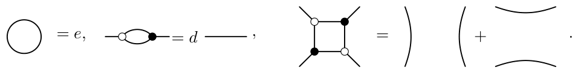
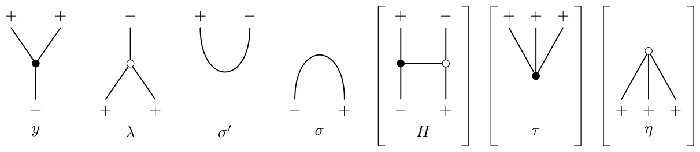
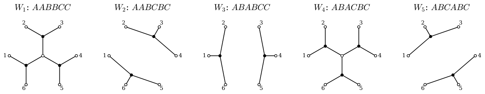
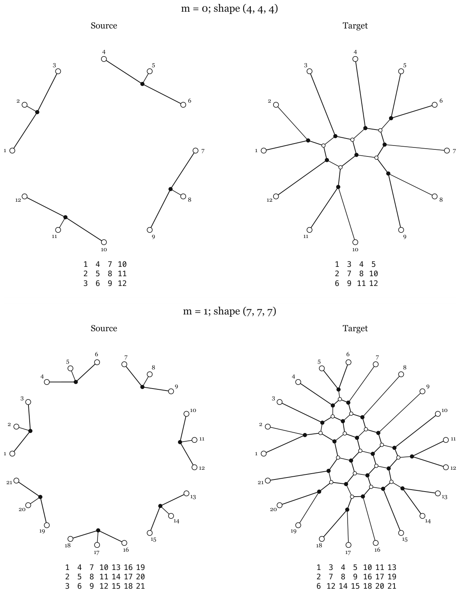
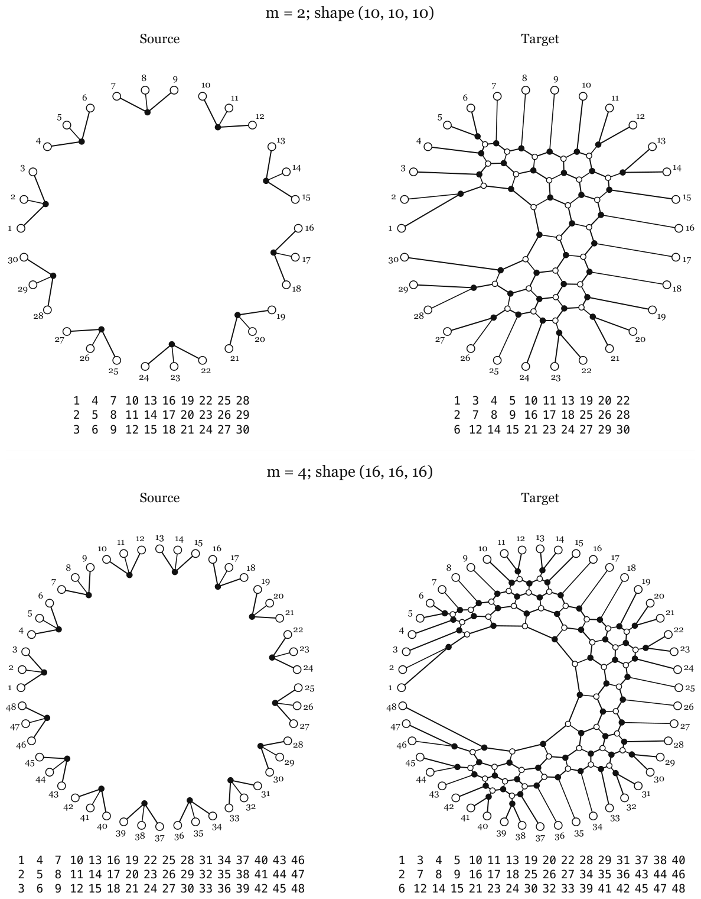

# 3. Webs and tensor coefficients

[Section index](README.md) · [Complete paper](../paper.md) · [AI reading guide](../../AI_README.md)

We now turn to webs. The basic idea is simple. The $\mathfrak{sl}_3$ invariant spaces $\operatorname{Inv}(V^{\otimes3N})$,
where $V$ is the three-dimensional fundamental representation, carry two natural bases: the web basis $W_w$, which is concrete and comparatively easy to compute, and the dual canonical basis $b_w$, which is subtler but, up to the standard identifications, corresponds to the KL basis. Thus our main task is to understand the change of basis from $W_w$ to $b_w$. Once this is explicit enough for our family, [Theorem 1B.1](01.md#thm:main) follows. This will occupy most of the paper.

### 3A. The planar calculus

Fix $\mathbb{K}=\mathbb Q(v)$ and $R=\mathbb Z[v]$, with $v$ a formal
parameter. Joining strands composes maps; placing
pictures side by side takes their tensor product. 
Moreover, before we even start recalling webs, we have the structure
of an operad/planar algebra:

**Lemma 3A.1.** For a pair of three-row rectangular tableaux, let $x,y$ be their
associated permutations from [Definition 2C.3](02.md#def:words). The symmetrized
coefficient $\mu(x,y)+\mu(y,x)$ is unchanged after simultaneously
rotating their webs and applying [Definition 2C.3](02.md#def:words) to the resulting
tableaux.

*Proof.* 
Rotation of a three-row rectangular web corresponds to promotion
of its tableau, see \[[PPR09](references.md#bib-PPR), Theorem 2.5\], and simultaneous promotion
preserves the symmetrized coefficient, see \[[Rho10](references.md#bib-Rhoades), Proposition 3.2\].
Rhoades writes this coefficient as $\mu[P,Q]$; the maximum of the
two ordered coefficients equals our sum, since at most one is nonzero. ∎

We draw most webs in a disk. When a picture specifies a map
or a tensor coordinate, its boundary order and labels are fixed.

**Definition 3A.2.** An $A_2$ web, or $\mathfrak{sl}_3$ web, is a planar graph in a disk or rectangle, with
ordered univalent boundary vertices and trivalent internal vertices.
Internal vertices are bipartite, and we draw them hollow and filled
for sources and sinks. Every edge is oriented from a source to a sink;
boundary signs use the input/output convention below. Closed circle components
are allowed. The boundary order, boundary signs, and cyclic orders of
edges at vertices are part of the data.

Set
$d=v+v^{-1}$, and $e=v^2+1+v^{-2}=d^2-1$.
The web category consists of $\mathbb{K}$-linear combinations of these
webs, modulo the circle, digon, and square relations in
[Figure 3](#fig:relations).

A web is non-elliptic if it has no circle component and no
internal digon or square face.

**Figure 3.** The $A_2$ relations. Hollow and filled internal vertices are
sources and sinks, respectively. All undisplayed parts of each web
remain fixed. Reversing all vertex types gives the same relations. [Diagram description](../diagrams.md#figure-3).

**Remark 3A.3.** For the reader familiar with e.g. \[[Kup96](references.md#bib-Kuperberg)\]:
hollow and filled internal vertices specify orientation, so arrows
can be omitted. At a positive output boundary vertex the edge enters the diagram;
at a positive input it leaves the diagram. Negative signs reverse
these conventions.

Let $V^+$ be the three-dimensional fundamental $U_{{v^{-1}}}(\mathfrak{sl}_3)$
module and $V^-$ its dual, in the normalization of [Equation 3C.1](#eq:localmaps) (we follow \[[KK99](references.md#bib-KK)\]); put $V=V^+$. 
An ordered sequence of signs represents a tensor product of these
modules. Vertical composition and horizontal juxtaposition represent
composition and tensor product of maps. A web with no inputs and $n$
positive outputs is therefore a map $\mathbf{1}\to V^{\otimes n}$, or
equivalently an invariant tensor. Here $\mathbf{1}$ is the one-dimensional
trivial module.

**Proposition 3A.4.** Non-elliptic $A_2$ webs form a basis of the corresponding
invariant tensor space. The web relations present the associated
intertwiner calculus.

*Proof.* 
This is the $A_2$ case of \[[Kup96](references.md#bib-Kuperberg), Sections 4–6, Theorems 5.1 and 6.1\]. ∎

The non-elliptic webs form bases of the invariant spaces, while the
standard tensors form a basis of the ambient tensor power. For $n=3N$,
the all-positive invariant space is the multiplicity space corresponding
to the rectangular partition $(N,N,N)$ under quantum Schur–Weyl
duality; see \[[FKK98](references.md#bib-FKK), Section 2\]. Below we work with the tensor
realization.

### 3B. Tableaux and the displayed family

The dominant word of [Definition 2C.1](02.md#def:words2) determines the leading
boundary state of a non-elliptic web. 
Starting from the tableau, read the second row from left to right,
matching each entry with the nearest unused smaller first-row entry.
Then match the third row with the second row in the same way.
Insert a trivalent vertex above each second-row boundary point,
and replace each crossing by a dumbbell, e.g.

$$
\text{crossing}
\rightsquigarrow
\text{vertical dumbbell}
\text{ or }
\text{horizontal dumbbell}
,
$$

where the choice between I (middle) and H (right) is determined by bipartiteness.
We denote the resulting web by $W_w$.

**Example 3B.1.** For $w=AABCBC$, the first matching gives $(2,3),(1,5)$,
and the second gives $(3,4),(5,6)$.
The arcs do not cross:

$$
\text{tableau }AABCBC\ \longmapsto\ \text{arc diagram}\ \longmapsto W_{AABCBC}
.
$$

Resolving the two boundary junctions gives tripods on
$(2,3,4)$ and $(1,5,6)$.

For $w=ABACBC$, the first matching gives $(1,2),(3,5)$,
and the second gives $(2,4),(5,6)$.
The arcs $(2,4)$ and $(3,5)$ cross once:

$$
\text{tableau }ABACBC\ \longmapsto\ \text{arc diagram}\ \longmapsto W_{ABACBC}
.
$$

Resolving the two boundary junctions and the crossing gives $W_w$.

**Lemma 3B.2.** The web $W_w$ is non-elliptic.

*Proof.* 
The KK growth
algorithm constructs this web directly from the word
\[[KK99](references.md#bib-KK), Section 5\]. The above description is Tymoczko's
equivalent construction \[[Tym12](references.md#bib-Tymoczko), Sections 2–4, Theorem 4.9\]. ∎

**Remark 3B.3.** There is another useful tableau-to-web construction in
\[[MPT14](references.md#bib-MPT), Section 4.1\]. The algorithm therein is
more general: it allows arbitrary sign strings and semistandard tableaux,
and naturally produces a web together with a flow. In the all-positive
standard case considered here, it recovers the same KK
web. Tymoczko's construction is more convenient for our purposes because
the intermediate arc diagram makes the web easy to draw.

### 3C. Elementary tensors and decorations

We fix the coordinates of the elementary web maps in
[Figure 4](#fig:generators). Here we draw maps in a rectangle,
with inputs at the bottom and outputs at the top.

**Figure 4.** The generators $y,\lambda,\sigma',\sigma$ are the split,
merge, cup and cap. The derived maps $H,\tau,\eta$ are bracketed;
$\tau$ is the tripod and $\eta$ its evaluation. Inputs are at the
bottom and outputs at the top; $+,-$ specify modules. Reversing
all signs and vertex types gives the other sign patterns. [Diagram description](../diagrams.md#figure-4).

Write $e_A,e_B,e_C$ for the standard basis vectors of either
signed module $V^\pm$, labeled by $1,0,-1$, respectively.
Their weights are $\varepsilon_1,\varepsilon_2,\varepsilon_3$
in $V^+$ and $-\varepsilon_3,-\varepsilon_2,-\varepsilon_1$ in $V^-$.
Here the $\varepsilon_i$ are the coordinate weights on the diagonal
traceless Cartan subalgebra, so $\varepsilon_1+\varepsilon_2+\varepsilon_3=0$.
For a word $w=w_1\cdots w_n$ in $\{A,B,C\}$, put
$e_w=e_{w_1}\otimes\cdots\otimes e_{w_n}$.
We often abbreviate $e_A,e_B,e_C$ to $A,B,C$ and $e_w$ to $w$,
with the signed tensor factors understood.
For example, $AB=e_A\otimes e_B$.
Comparisons use the order $A<B<C$, and $\delta_{a<b}$ is an indicator.
The notation $[e_w]f$ denotes the coefficient of $e_w$ in $f$.

The cup and cap are
$\sigma':\mathbf{1}\to V^+\otimes V^-$ and
$\sigma:V^-\otimes V^+\to\mathbf{1}$.
The trivalent maps and the cup and cap are given in coordinates
by the following formulas. Here $\nu(a,b)=\nu(ab)$ is the label assigned to the unordered pair $\{a,b\}$ below.

**Equation 3C.1.**

$$
\begin{gathered}
y(A)=AB+v BA,\qquad y(B)=AC+v CA,\qquad y(C)=BC+v CB,\\
\lambda(ab)=v^{-\delta_{a<b}}\nu(a,b)\quad(a\ne b),
\qquad \lambda(aa)=0,\\
\nu(AB)=A,\qquad \nu(AC)=B,\qquad \nu(BC)=C,
\qquad \nu(a,b)=\nu(b,a),\\[2pt]
\sigma'(1)=AC+v BB+v^2CA,\qquad
\sigma(AC)=v^{-2},\quad \sigma(BB)=v^{-1},\quad \sigma(CA)=1,\\
\sigma(s)=0\quad(s\notin\{AC,BB,CA\}).
\end{gathered}
$$

The same formulas apply after globally reversing the signs and vertex
types. The map $H$ exchanges opposite boundary signs by a planar web.

**Remark 3C.2.** The formulas in [Equation 3C.1](#eq:localmaps) are as in
\[[KK99](references.md#bib-KK), Section 2\], with $v=-q_{\rm KK}^{-1/2}$.

For the derived maps in [Figure 4](#fig:generators), put
$H=(I\otimes\lambda)(y\otimes I)$,
$\tau=(I\otimes y)\sigma'$ and $\eta=\sigma(\lambda\otimes I)$.
Their coordinates are

$$
\begin{array}{c|ccccccccc}
s&AA&AB&AC&BA&BB&BC&CA&CB&CC\\\hline
H(s)&AA&BA&v^{-1} AC+BB&AB&AC+CA&CB&BB+v CA&BC&CC
\end{array},
$$

while the nonzero coordinates of $\tau,\eta$, ordered as $ABC,ACB,BAC,BCA,CAB,CBA$, are

**Equation 3C.3.**

$$
\tau=(1,v,v,v^2,v^2,v^3)^{\mathsf T},\qquad
\eta=(v^{-3},v^{-2},v^{-2},v^{-1},v^{-1},1).
$$

In particular,
$\tau^{\mathsf T}=v^3\eta$ and $\eta\tau=de$.
Transpose throughout means ordinary coordinate transpose over $\mathbb{K}$, and we write $\tau^j$ for the tensor
product of $j$ tripods.

**Remark 3C.4.** Fix the states on the boundary edges of a web.
A compatible decoration labels each internal edge by $A,B$ or $C$
so that the corresponding local coefficients in
[Equation 3C.1](#eq:localmaps) are nonzero.
Its weight is the product of these coefficients.
The coefficient for the fixed boundary states is the sum of these
weights over all compatible decorations.

### 3D. The dual canonical condition

We first recall the bar involution. For a sign word
$S=s_1\cdots s_n$, write
$V^S=V^{s_1}\otimes\cdots\otimes V^{s_n}$.
On $V^+$ and $V^-$, the bar fixes the standard basis vectors and sends
$v$ to $v^{-1}$. On tensor products it is not the entrywise bar.
Instead, Lusztig's tensor bar
$\Phi_S\colon V^S\longrightarrow V^S$
is defined inductively using the quasi $R$-matrix $\overline\Theta$: if
$S=TT'$, then
$\Phi_S(x\otimes y) = \overline\Theta\bigl(\Phi_T(x)\otimes\Phi_{T'}(y)\bigr)$.
Thus $\Phi_S$ is $v$-antilinear and is the bar involution relevant for
the dual canonical basis. We will use [Lemma 3D.1](#lem:web-bar) to establish
bar invariance without computing the tensor bar explicitly. For its
construction, see \[[Lus93](references.md#bib-Lusztig), Chapter 27\] and
\[[KK99](references.md#bib-KK), Section 6\].

**Lemma 3D.1.** Every web (without linear combination) is bar equivariant. More precisely, if a web represents
a map
$W\colon V^S\longrightarrow V^{S'}$,
then
$\Phi_{S'}\circ W=W\circ\Phi_S$.

*Proof.* 
This is proved for arbitrary monomial web maps in the proof of
\[[KK99](references.md#bib-KK), Proposition 2\]. ∎

The point of [Lemma 3D.1](#lem:web-bar) is that bar invariance does not
distinguish the web basis from the dual canonical basis. The difference
is the triangularity condition.

**Proposition 3D.2.** For every sign word $S$ of length $n$ and every state word
$w\in\{A,B,C\}^n$, there is a unique tensor $b_w\in V^S$
(the dual canonical basis element) fixed by $\Phi_S$ and satisfying

$$
b_w\equiv e_w\pmod{v\bigoplus_z R e_z}.
$$

For $S=+^{3N}$, the vectors $b_w$ indexed by dominant words of
content $(N,N,N)$ form a basis of $\operatorname{Inv}(V^{\otimes3N})$.

*Proof.* 
The canonical basis input is Lusztig's tensor product construction
\[[Lus93](references.md#bib-Lusztig), Chapter 27\].
In the exact conventions used here, see
\[[KK99](references.md#bib-KK), Theorem 3\]. The invariant subspace assertion is
\[[Lus93](references.md#bib-Lusztig), Section 27.2.5\], recalled in \[[KK99](references.md#bib-KK), Section 6\]. ∎

**Example 3D.3.** There are five dominant words for $(2,2,2)$:

$$
w_1=AABBCC,\quad w_2=AABCBC,\quad
w_3=ABABCC,\quad w_4=ABACBC,\quad w_5=ABCABC.
$$

Their five webs are shown in [Figure 5](#fig:six). Columns in the following
matrix are webs, and rows are the selected standard tensor states $e_{w_i}$:

**Equation 3D.4.**

$$
\bigl([e_{w_i}]W_{w_j}\bigr)_{i,j}=
\begin{pmatrix}
1&0&0&0&0\\
v&1&0&0&0\\
v&0&1&0&0\\
v^2&v&v&1&0\\
v&v^2&v^2&v&1
\end{pmatrix}.
$$

For example, $[e_{ABCABC}]W_{AABBCC}=v$, while
$[e_{ABCABC}]W_{ABCABC}=1$. The entries come from the elementary
tables above. All five webs are dual canonical, also by \[[KK99](references.md#bib-KK), Theorem 1\]:
in their full tensor
expansions the leading coordinate is $1$ and every other coordinate
belongs to $v\mathbb{Z}[v]$. Thus [Equation 3D.4](#eq:sixcoordinates) is a tensor-coordinate
matrix, even though the web-to-dual-canonical matrix here is the identity.

**Figure 5.** The five all-positive six-point webs, in the order of
[Example 3D.3](#ex:six). The boundary order starts at the left and goes clockwise. [Diagram description](../diagrams.md#figure-5).

### 3E. A teaser for our main family

[Figure 6](#fig:family01) and [Figure 7](#fig:family24) show
$W_{a_m}$ and $W_{c_m}$ for $m\in\{0,1,2,4\}$. These webs are
non-elliptic, but $W_{c_m}$ need not be dual canonical. By
[Theorem 1B.1](01.md#thm:main) and [Lemma 2C.10](02.md#lem:lengths), the corresponding
$\mu$-coefficients are $1,0,2,4$, respectively.

**Figure 6.** The indexing webs for $m=0$ and $m=1$, with tableaux below
each diagram. Boundary labels are fixed; edges join opposite vertex
types. [Diagram description](../diagrams.md#figure-6).

**Figure 7.** The members $m=2$ and $m=4$, of shapes $(10,10,10)$ and
$(16,16,16)$. [Diagram description](../diagrams.md#figure-7).
