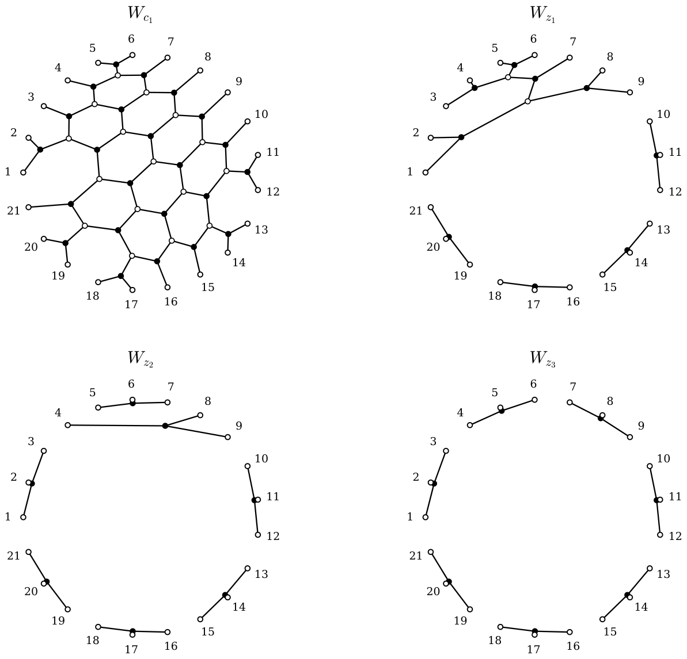
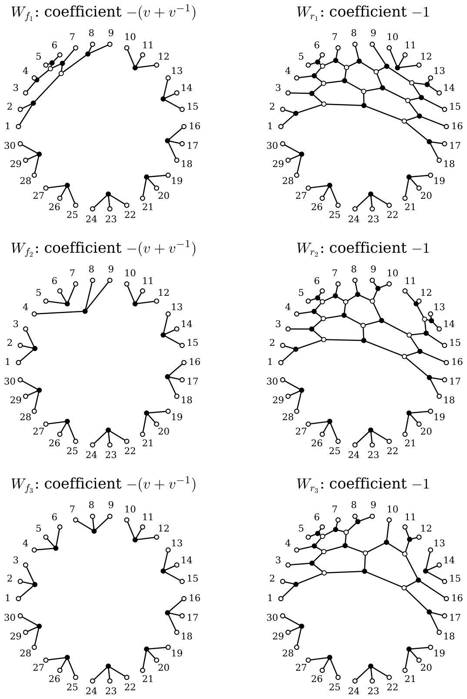

# 5. From webs to the dual canonical basis

[Section index](README.md) · [Complete paper](../paper.md) · [AI reading guide](../../AI_README.md)

We now explain a crucial change of basis.

### 5A. Three kinds of coordinates

Fix a boundary with $3N$ positive signs and write $\mathcal D_N$ for
the dominant words of content $(N,N,N)$. A word $w$ in $\mathcal D_N$ labels
two invariant tensors: the non-elliptic (ne) web $W_w$ and the dual canonical (dc) vector $b_w$.
For any state word $s\in\{A,B,C\}^{3N}$, the state tensor (s) $e_s$
is a third object; it is usually not invariant. The word $s$ need not be dominant. 
For clarity, the three bases and their uses are

| Basis | Space | Use in the proof |
| --- | --- | --- |
| $\{e_s\}$, all state words | $V^{\otimes3N}$ | Tensor coefficients |
| $\{W_w:w\in\mathcal D_N\}$ | $\operatorname{Inv}(V^{\otimes3N})$ | Planar construction |
| $\{b_w:w\in\mathcal D_N\}$ | $\operatorname{Inv}(V^{\otimes3N})$ | FKK and KL coefficients |

.

Order state strings lexicographically with $C\prec B\prec A$; write
$z\prec w$ when the state string for $z$ is smaller. This is the
reverse of lexicographic order on words with $A<B<C$. Then \[[FKK98](references.md#bib-FKK), proof of Proposition $2.4'$\], \[[KT02](references.md#bib-KashiwaraTanisaki), Corollary 4.5\],
\[[KK99](references.md#bib-KK), Theorem 2\], 
and \[[Tub14](references.md#bib-TubbenhauerCrystal), Corollary 3.7\] give

$$
\begin{gathered}
\begin{aligned}
W_w&=e_w+\sum_{s\prec w}\mathcal M_{s,w}(v)e_s,
&&\mathcal M_{s,w}(v)\in\mathbb{Z}_{\geq 0}[v,v^{-1}],\text{(ne in s coordinates)}\\
b_w&=e_w+\sum_{s\prec w}\mathcal N_{s,w}(v)e_s,
&&\mathcal N_{s,w}(v)\in v\mathbb{Z}_{\geq 0}[v],\text{(dc in s coordinates)}\\
b_w&=W_w+\sum_{z\prec w}\mathcal K_{z,w}(v)W_z,
&&\mathcal K_{z,w}(v)\in\mathbb{Z}[v,v^{-1}],\text{(dc in ne coordinates)}.
\end{aligned}
\end{gathered}
$$

In the first two sums $s$ ranges over all tensor state words;
in the last, $z$ ranges over dominant words.

**Lemma 5A.1.** Suppose
$b_w=\sum_z \mathcal K_{z,w}(v)W_z$.
Then
$\mathcal K_{z,w}(v)=\mathcal K_{z,w}(v^{-1})$
for all $z,w$.

*Proof.* 
Both $b_w$ and every web $W_z$ are fixed by the tensor bar, cf. [Lemma 3D.1](03.md#lem:web-bar)
and [Proposition 3D.2](03.md#thm:canonical). Applying the bar to the expansion above therefore gives
$b_w=\sum_z \mathcal K_{z,w}(v^{-1})W_z$.
Since the $W_z$ form a basis, uniqueness of the expansion implies
$\mathcal K_{z,w}(v)=\mathcal K_{z,w}(v^{-1})$. ∎

Write $\mathcal M$ for the matrix from ne coordinates to s coordinates,
$\mathcal N$ for the matrix from dc coordinates to s,
and $\mathcal K$ for the change-of-basis matrix from dc to
ne. Thus $\mathcal N=\mathcal M\mathcal K$, with

$$
[e_a]b_w=[e_a]W_w+\sum_{z\prec w}\mathcal K_{z,w}(v)[e_a]W_z.
$$

The coefficient used by FKK is an entry of $\mathcal N$, and the correction
from $W_w$ to $b_w$ is an entry of $\mathcal K$.

### 5B. What the correction removes

The following is the usual intermediate-basis-calculation as e.g. in
\[[LT00](references.md#bib-LeclercToffin), Section 4.2\] or \[[Tub14](references.md#bib-TubbenhauerCrystal)\].

**Lemma 5B.1.** Let $w\in\mathcal D_N$. Process the lower dominant labels
$z\prec w$ from largest to smallest. If the current coefficient at
$e_z$ has constant and negative part
$\alpha_0+\sum_{k>0}\alpha_{-k}v^{-k}$, subtract
$(\alpha_0+\sum_{k>0}\alpha_{-k}(v^{-k}+v^k))b_z$.
Repeating this produces $b_w$ and stays in the invariant subspace.

*Proof.* 
The correction coefficient has the required bad part and is
bar invariant. The remaining coordinates of $b_z$ lie below $z$, so
elimination cannot spoil a coordinate already treated. To see that
dominant labels suffice, expand $W_w$ in the invariant basis
$\{b_z\mid z\in\mathcal D_N\}$. Its leading term is $b_w$, and the
lower coefficients are bar-invariant Laurent polynomials. At each
step the bad part recovers the full coefficient of the largest
remaining $b_z$, since $[e_z]b_w\in v\mathbb{Z}[v]$. Thus all lower summands
are removed, leaving $b_w$. ∎

The tensors remain invariant throughout, but the congruence in
[Proposition 3D.2](03.md#thm:canonical) concerns all tensor coordinates, including nondominant states. For instance, at a lower
dominant label $z$, a residual coefficient $v^{-1}+3v$ is corrected by
subtracting $(v+v^{-1})b_z$, leaving $2v$ at $e_z$.

**Example 5B.2.** Consider $c_1=ABAAAC\,BBBAACACC\,BBCBCC$.
Put

$$
z_1=ABABACCBC(ABC)^4,\quad
z_2=ABCAABCBC(ABC)^4,\quad z_3=(ABC)^7.
$$

Each $W_{z_i}$ has no internal faces, cf.
[Figure 8](#fig:oneblockchange), and is therefore dual canonical
by the argument in \[[KK99](references.md#bib-KK), proof of Proposition 3\]. For $i=1$ it is a nine-point web
followed by four disjoint tripods; for $i=2$ it is a tripod followed by the
six-point web in [Example 3B.1](03.md#ex:tableau-to-web) and four further tripods;
for $i=3$ it is seven tripods.

The full nonpositive $v$-degree part of $W_{c_1}$ is

$$
e_{c_1}+e_{z_1}+e_{z_2}+e_{z_3}.
$$

The corresponding part of $W_{z_i}$ is just $e_{z_i}$. Hence

**Equation 5B.3.**

$$
b_{c_1}=W_{c_1}-W_{z_1}-W_{z_2}-W_{z_3}.
$$

This is an actual web-to-dual-canonical change of basis. On the
four-dimensional span of these webs, its matrix is

$$
(b_{z_1},b_{z_2},b_{z_3},b_{c_1})
=(W_{z_1},W_{z_2},W_{z_3},W_{c_1})
\begin{pmatrix}1&0&0&-1\\0&1&0&-1\\0&0&1&-1\\0&0&0&1\end{pmatrix}.
$$

For $a_1=(ABC)^7$, direct tensor contraction gives

$$
\begin{aligned}
[e_{a_1}]W_{c_1}&=1+10v^2+30v^4+24v^6+3v^8,\\
[e_{a_1}](W_{z_1}+W_{z_2}+W_{z_3})&=1+2v^2,\\
[e_{a_1}]b_{c_1}&=8v^2+30v^4+24v^6+3v^8.
\end{aligned}
$$

The correction removes the extra constant coefficient.

**Figure 8.** The four webs in [Equation 5B.3](#eq:oneblockchange). The lower webs
have isolated tripod components, which are retained at their actual
boundary positions. All four diagrams have $21$ positive boundary points. [Diagram description](../diagrams.md#figure-8).

### 5C. The two-block example: the actual lower webs

For $c_2=\mathtt{S}\mathtt{M}^2\mathtt{E}$ the tensor coordinate $[e_{a_2}]W_{c_2}$ is already enough to
detect a failure of canonicality:

**Equation 5C.1.**

$$
\begin{aligned}
[e_{a_2}]W_{c_2}
&=v^{-1}+18v+125v^3+409v^5+617v^7+377v^9+77v^{11}+4v^{13},\\
[e_{a_2}]b_{c_2}
&=2v+70v^3+355v^5+607v^7+377v^9+77v^{11}+4v^{13}.
\end{aligned}
$$

The first line contains $v^{-1}$ and therefore cannot be the
coordinate of a dual canonical vector with another leading state.
The correction contributes $v^{-1}+16v+55v^3+54v^5+10v^7$.
Thus the required coefficient of $v$ is $18-16=2$.
This is $\mu(x_2,y_2)$ by [Proposition 4A.1](04.md#thm:FKK): for the length gap $45$,
the FKK normalization sends the critical power $q^{22}$ to
$v^{45-2\cdot22}=v$.
The complete correction has $94$ lower webs. Split their indexing words
into sets $\mathcal R$ and $\mathcal F$ according to the multiplier:

**Equation 5C.2.**

$$
b_{c_2}=W_{c_2}
-\sum_{z\in\mathcal R}W_z
-(v+v^{-1})\sum_{z\in\mathcal F}W_z,
\qquad |\mathcal R|=91,\quad |\mathcal F|=3.
$$

All words in these sets have ten occurrences of each letter and are
strictly below $c_2$ in the state order. The three words in
$\mathcal F$ are particularly simple:

$$
f_1=ABABACCBC(ABC)^7,\qquad
f_2=ABCAABCBC(ABC)^7,\qquad f_3=(ABC)^{10}.
$$

Thus $W_{f_1}$ and $W_{f_2}$ have the same nine-point cores as the lower
webs in [Example 5B.2](#ex:oneblockchange), with seven tripods appended.
The web $W_{f_3}$ consists of ten tripods. Three examples from
$\mathcal R$ are

$$
\begin{aligned}
r_1&=ABAAACBBBABCACCCBC(ABC)^4,\\
r_2&=ABAAACBBBCABACCCBC(ABC)^4,\\
r_3&=ABAAACBBCBACABCCBC(ABC)^4.
\end{aligned}
$$

Their pictures are in [Figure 9](#fig:twoblocklower); the indicated
coefficients are entries of $\mathcal K$, not tensor coordinates.

**Figure 9.** Six lower webs in [Equation 5C.2](#eq:94correction). The left column
contains all three Laurent corrections; the right column shows three
of the $91$ corrections with coefficient $-1$. Every diagram has
$30$ positive boundary points, numbered in the same order as $c_2$.
The first two left webs share the seven tripods at positions $10$ to $30$. [Diagram description](../diagrams.md#figure-9).

In this example every one of the $94$ lower webs is itself dual
canonical: $W_z=b_z$ for $z\in\mathcal R\cup\mathcal F$.
Consequently the inverse change of basis is just

$$
W_{c_2}=b_{c_2}+\sum_{z\in\mathcal R}b_z
+(v+v^{-1})\sum_{z\in\mathcal F}b_z.
$$

The raw web therefore has one desired canonical summand and $94$ lower
ones. Removing the latter gives $b_{c_2}$. These identities and the
canonicality of the lower webs are checked in all tensor coordinates
by the accompanying script.

Here is how the pictured terms affect the coordinate at $a_2=(ABC)^{10}$.

| Web | Coefficient in $b_{c_2}$ | Tensor coordinate $[e_{a_2}]W_z$ |
| --- | --- | --- |
| $W_{f_1}$ | $-(v+v^{-1})$ | $v^2$ |
| $W_{f_2}$ | $-(v+v^{-1})$ | $v^2$ |
| $W_{f_3}$ | $-(v+v^{-1})$ | $1$ |
| $W_{r_1}$ | $-1$ | $v+5v^3+3v^5$ |
| $W_{r_2}$ | $-1$ | $v^3+4v^5+v^7$ |
| $W_{r_3}$ | $-1$ | $v+3v^3+v^5$ |

For the three Laurent terms, multiplication by $v+v^{-1}$ gives

$$
(v+v^{-1})(v^2+v^2+1)=v^{-1}+3v+2v^3.
$$

The remaining $91$ terms give

$$
[e_{a_2}]\sum_{z\in\mathcal R}W_z
=13v+53v^3+54v^5+10v^7.
$$

This accounts for every coefficient of the correction in
[Equation 5C.1](#eq:raw-two-coordinate). In particular, the three Laurent terms
remove $3v$, the other terms remove $13v$, and $18-3-13=2$ remains.
The negative power is canceled by the $f_3$ term. Its paired positive
power is forced by bar invariance, so it also changes the coefficient
we are trying to compute.

One can also see why the final check must include nondominant states.
Take $s=BAABACCBC(ABC)^7$, which starts with $B$ and is therefore
not dominant. Direct contraction gives

$$
[e_s]W_{f_1}=v,\qquad
[e_s]\bigl((v+v^{-1})W_{f_1}\bigr)=1+v^2.
$$

The raw web has constant coefficient $1$ at $e_s$, and this correction
removes it. A calculation confined to the dominant indexing words
would miss this coordinate. The raw web has $156$ nonzero coordinates
in nonpositive $v$-degree, of which $58$ are nondominant. After the
full correction, only the leading coordinate $e_{c_2}$ remains in
those degrees.

**Remark 5C.3.** The calculation above can be checked by hand, but arguably this is
neither pleasant nor a good use of time.
For a computer check, `M2Data.lean` lists all $94$ lower words,
their multipliers and their coordinates at $a_2$, and
`M2Flow.lean` provides the tensor contraction routine.
Both files are in `code/Lean/WebMu/Revised/`
in the repository \[[G+26b](references.md#bib-GoLaTuVa-mu-code)\].

### 5D. From one column to the uniform construction

Listing such a column separately for every $m$ would not give a
uniform proof. Instead, [Section 6](06.md#sec:construction) builds a web
combination $\beta_m$ from five fixed maps.
Here $\Psi_{\mathtt M}$ is the block map and $\Psi_{+},\Psi_{-}$ are correction maps.
Identity maps on external strands are understood in these compositions.
For two blocks it is

$$
\beta_2=\Psi_{\mathtt S}\Psi_{\mathtt M}^2\Psi_{\mathtt E}-\Psi_{\mathtt S}\Psi_{+}\Psi_{-}\Psi_{\mathtt E}-\Psi_{\mathtt S}\Psi_{\mathtt M}\Psi_{+}\tau^2+d\Psi_{\mathtt S}\Psi_{+}\tau^5=(\Psi_{\mathtt S},0)\cdot\begin{pmatrix}\Psi_{\mathtt M}&-\Psi_{+}\\\Psi_{-}&-d\tau^3\end{pmatrix}^2\cdot\binom{\Psi_{\mathtt E}}{\tau^2},
$$

where $\Psi_{\mathtt S}\Psi_{\mathtt M}^2\Psi_{\mathtt E}=W_{c_2}$ and $d=v+v^{-1}$. Similarly, we have

$$
\beta_1=\Psi_{\mathtt S}\Psi_{\mathtt M}\Psi_{\mathtt E}-\Psi_{\mathtt S}\Psi_{+}\tau^2=(\Psi_{\mathtt S},0)\cdot\begin{pmatrix}\Psi_{\mathtt M}&-\Psi_{+}\\\Psi_{-}&-d\tau^3\end{pmatrix}\cdot\binom{\Psi_{\mathtt E}}{\tau^2}.
$$

Expanding the three correction
terms of $\beta_2$ in the non-elliptic web basis gives the column above. Grouping
them by the three-strand interface produces a formula that extends
to every $m$. The local degree argument in [Section 7](07.md#sec:canonicality)
proves that this construction indeed gives $\beta_m=b_{c_m}$.

### 5E. The categorical interpretation

For readers who prefer categorification, a web defines a projective
module over the web algebra \[[MPT14](references.md#bib-MPT)\]. Such a projective can split.
The dual canonical basis corresponds instead to normalized
indecomposable projectives \[[Mac14](references.md#bib-MackaayDual), Corollary 7.9\]. The
cyclotomic Hecke/KLR comparison and its canonical-basis-consequences
are developed in \[[BK09a](references.md#bib-BrundanKleshchevBlocks), [BK09b](references.md#bib-BrundanKleshchev)\].
Robert's red graphs detect certain splittings geometrically
\[[Rob13](references.md#bib-RobertFamily), [Rob15](references.md#bib-RobertCharacterization)\]. This explains why reducing
a web can reveal correction terms. The tensor calculation still has
to establish the coefficients and the leading state of the desired
canonical vector. In our proof these are supplied by the fixed maps
and their local degree bounds.
