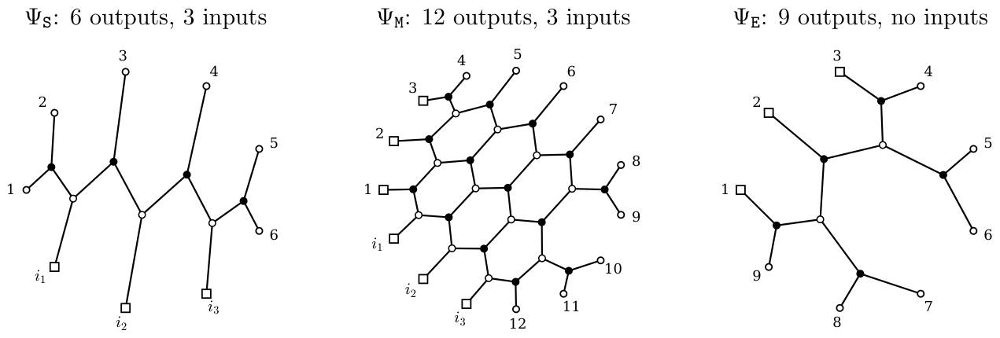
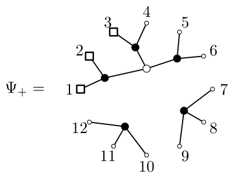
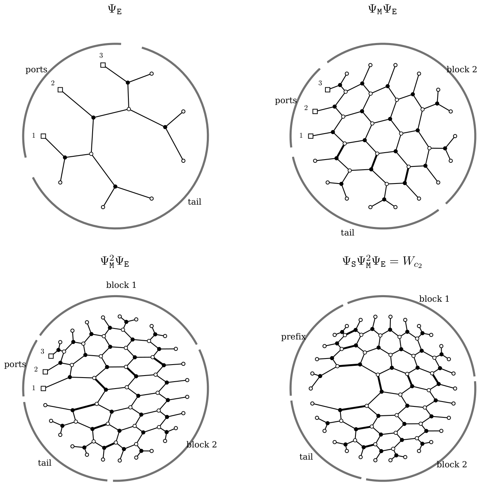
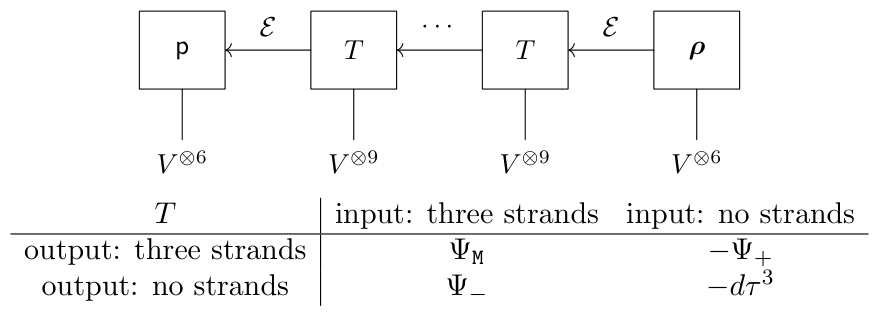

# 6. A corrected tensor on a fixed interface

[Section index](README.md) · [Complete paper](../paper.md) · [AI reading guide](../../AI_README.md)

We construct $\beta_m$ from fixed prefix (start), block (middle) and tail (end) maps, with corrections at each block. We will prove $\beta_m=b_{c_m}$ below.
The raw web has three connecting strands, with $3^3=27$
tensor states. Some correction terms have no connecting strands across
the cut; a scalar coordinate records this case. The connecting space
therefore has dimension
$27+1=28$, independently of $m$. This fixed dimension makes the computation possible: after
fixing the output state, the iteration reduces to calculations with
$28\times28$ matrices.

### 6A. Growth strings and local maps

The following strings specify the maps completely. They use the
KK growth operations \[[KK99](references.md#bib-KK), Section 5\].
Recall that $c_m=\mathtt{S}\mathtt{M}^m\mathtt{E}$, with a six-letter prefix $\mathtt{S}$, a nine-letter
block $\mathtt{M}$, and a six-letter tail $\mathtt{E}$.
A downward growth string reduces the output boundary to the input
boundary. Read it from left to right, renumbering the remaining
strands from zero after each step. The signs $+,-$ specify
$V^\pm$, independently of the state labels $A,B,C$. The operation $Y_i$ merges the equal-sign
strands at positions $i,i+1$; $H_i$ applies the two-vertex web $H$ to
opposite signs; and $a_i$ removes an adjacent opposite-sign pair.
The remaining signs are the input signs of the map.

To construct the map upward, read the string in reverse, replacing
$Y_i$ by a split $y$ and $a_i$ by a cup $\sigma'$.
The operation $H_i$ uses the planar web $H$ in
[Figure 4](03.md#fig:generators); identity maps act on the other strands.
This fixes the graph and its cyclic orders.

To compute a covector from a fixed output state, read downward
using the ordinary coordinate transposes of the upward maps.

The correction tables also use maps on three positive input strands.
Put

$$
\lambda_1=\lambda\otimes I,
\qquad \lambda_2=I\otimes\lambda,
\qquad E_1=(y\lambda)\otimes I,
\qquad E_2=I\otimes(y\lambda).
$$

Thus $\lambda_1$ acts on the first two strands and $\lambda_2$ on the
last two; the subscripts here are numbered from one. Products of maps
are composed from right to left, so $\lambda_2E_1$ first applies $E_1$.
This convention for composition is distinct from the left-to-right
reading of a downward growth string.

The prefix $\Psi_{\mathtt S}$, block $\Psi_{\mathtt M}$ and tail $\Psi_{\mathtt E}$ correspond to
$\mathtt{S},\mathtt{M},\mathtt{E}$, respectively. Together with the correction
maps $\Psi_{+},\Psi_{-}$, they have types

$$
\begin{array}{ll}
\Psi_{\mathtt S}:V^{\otimes3}\to V^{\otimes6},&
\Psi_{\mathtt M}:V^{\otimes3}\to V^{\otimes3}\otimes V^{\otimes9},\\
\Psi_{\mathtt E}:\mathbf{1}\to V^{\otimes3}\otimes V^{\otimes6},&
\Psi_{+}:\mathbf{1}\to V^{\otimes3}\otimes V^{\otimes9},\\
\Psi_{-}:V^{\otimes3}\to V^{\otimes9}.&
\end{array}
$$

For the block and tail, we have bent three negative inputs
into the first three positive outputs, preserving the boundary order.
Before bending, these pieces have types
$(V^-)^{\otimes3}\otimes V^{\otimes3}\to V^{\otimes9}$ and
$(V^-)^{\otimes3}\to V^{\otimes6}$, respectively.
The first three outputs are the connecting strands; the remaining
outputs carry $\mathtt{M}$ or $\mathtt{E}$.
The map $\Psi_{+}$ creates the three connecting strands, and
$\Psi_{-}$ removes them.
Start with $6$, $12$ and $9$ positive output strands for the
prefix, block and tail, respectively. The following strings
define $\Psi_{\mathtt S},\Psi_{\mathtt M},\Psi_{\mathtt E}$; see [Figure 10](#fig:pieces).

**Equation 6A.1.**

$$
\begin{aligned}
\Psi_{\mathtt S} &:Y_0Y_3H_2H_1Y_0,\\
\Psi_{\mathtt M} &:Y_2Y_6Y_7H_2Y_1H_2H_1Y_0H_3Y_2H_3Y_4H_2Y_1H_2H_1Y_0,\\
\Psi_{\mathtt E} &:Y_2Y_3Y_2Y_1Y_2Y_1Y_0a_0.
\end{aligned}
$$

With one-based numbering, the prefix string is precisely
$Y_1Y_4H_3H_2Y_1$. In particular, its first operation merges the first
two positive strands, whose leading state labels are $A,B$.

**Figure 10.** The three pieces of the raw web. The inputs $i_1,i_2,i_3$
of $\Psi_{\mathtt S}$ and $\Psi_{\mathtt M}$ are joined to outputs $1,2,3$ of the next piece.
Squares mark the three-strand interfaces.
All labels refer to the local piece, before gluing. [Diagram description](../diagrams.md#figure-10).

These strings reduce the leading states as
$\mathtt{S}\to AAA$, $AAA\,\mathtt{M}\to AAA$, and $AAA\,\mathtt{E}\to\varnothing$.
For the tail, the first three merges give
$AAA\,\mathtt{E}\to AAABCBCC\to AAACBCC\to AABBCC$.
The remaining steps reduce $AABBCC$ to the empty boundary using only
$Y$ and $a$; no $H$ is needed.
For the longer strings, abbreviate
$\mathsf R_i=H_{i+1}Y_i$ and $\mathsf S=H_2H_1Y_0$.

To define $\Psi_{+}$, let $O$ be the map with twelve positive outputs and
downward string $Y_2Y_6Y_7\mathsf R_1$. Its eight surviving input
signs are $+--++--+$. Pair these inputs consecutively by four cups,
and denote the resulting tensor by $\kappa_8$. Then $\Psi_{+}=O\kappa_8$.
The resulting web is shown in [Figure 11](#fig:correction).
It gives the correction in [Example 5B.2](05.md#ex:oneblockchange):

$$
\Psi_{\mathtt S}\Psi_{+}\tau^2=W_{z_1}+W_{z_2}+W_{z_3}.
$$

**Figure 11.** The correction map
$\Psi_{+}=W_{ABACBC}\otimes\tau^2$.
Squares mark outputs $1,2,3$, which are reserved for the next attachment. [Diagram description](../diagrams.md#figure-11).

The second correction is $\Psi_{-}=\sum_{i=1}^8D_i$. Each term is
$D_i=P_i h_i$, where $P_i$ has nine positive outputs and the downward
string in the table. The last column gives the input signs of $P_i$;
they agree with the output signs of the small map $h_i$.

| Map | Downward growth of $P_i$ | $h_i$ | Input signs of $P_i$ |
| --- | --- | --- | --- |
| $D_1$ | $Y_0Y_3Y_4a_4\mathsf S$ | $I$ | $+++$ |
| $D_2$ | $Y_0Y_3Y_4Y_3Y_2\mathsf R_0$ | $I$ | $+++$ |
| $D_3$ | $Y_0Y_2a_2Y_2\mathsf R_0Y_1$ | $\lambda_2$ | $+-$ |
| $D_4$ | $Y_0Y_1Y_2Y_1Y_2\mathsf R_0Y_1$ | $\lambda_2E_1$ | $+-$ |
| $D_5$ | $Y_0Y_1Y_0Y_1Y_2Y_1Y_1$ | $\lambda_2$ | $+-$ |
| $D_6$ | $Y_0a_0Y_1Y_2Y_1Y_1$ | $\lambda_2E_1$ | $+-$ |
| $D_7$ | $Y_0a_0Y_0a_0Y_0$ | $\lambda_1$ | $-+$ |
| $D_8$ | $Y_0a_0Y_0a_0Y_0a_0$ | $\eta$ | $\varnothing$ |

All eight terms have coefficient $1$. The signs of the correction
are specified in [Equation 6C.2](#eq:maps). See also [Figure 40](appendix-b.md#fig:atlas-term4) for the corresponding webs.

### 6B. Gluing the basic pieces

Start with $\Psi_{\mathtt E}$, leaving its last six outputs external. At each
of the $m$ steps, join the first three outputs to the inputs of
$\Psi_{\mathtt M}$, in order. Keep the block's first three outputs for the next
attachment and leave its other nine outputs external. Finally
attach $\Psi_{\mathtt S}$, whose six outputs complete the prefix.

**Lemma 6B.1.** For every $m\ge0$, this gluing gives

$$
W_{c_m}=\Psi_{\mathtt S}\Psi_{\mathtt M}^m\Psi_{\mathtt E},\qquad
6+9m+6=12+9m\text{ external outputs}.
$$

*Proof.* 
The strings in [Equation 6A.1](#eq:growth) are admissible growth
steps on $\mathtt{S}$, $AAA\,\mathtt{M}$ and $AAA\,\mathtt{E}$. Applying them
successively from the prefix to the tail reduces $c_m$ to the empty
boundary. The growth algorithm therefore identifies the assembled
web with $W_{c_m}$ \[[KK99](references.md#bib-KK), Section 5, Lemmas 1–3\]. ∎

The main proof identifies $\beta_m$ directly by its tensor congruence
and does not depend on this raw web identification. 
In the notation $\Psi_{\mathtt S}\Psi_{\mathtt M}^m\Psi_{\mathtt E}$, each new block acts only on
the three reserved strands; identity maps on the external strands
are understood.

**Example 6B.2.** Start with $\Psi_{\mathtt E}$, attach one copy of $\Psi_{\mathtt M}$, attach a second copy, and
close the three reserved outputs with $\Psi_{\mathtt S}$; see [Figure 12](#fig:assembly).
The blocks are attached from the tail towards the prefix.
The intermediate diagrams have $9,18,27$ outputs, of which three
are still reserved. The final diagram has $30$ external outputs.
Their order is

$$
\underbrace{1,\ldots,6}_{\mathtt{S}}\quad
\underbrace{7,\ldots,15}_{\mathtt{M}}\quad
\underbrace{16,\ldots,24}_{\mathtt{M}}\quad
\underbrace{25,\ldots,30}_{\mathtt{E}}.
$$

This constructs $W_{c_2}$. The tensor giving
$\mu=2$ is obtained by adding the correction in
[Definition 6C.1](#def:corrected); the raw web still has the forbidden
$v^{-1}$ coordinate in [Equation 5C.1](05.md#eq:raw-two-coordinate).

**Figure 12.** The assembly $\Psi_{\mathtt E}\longmapsto \Psi_{\mathtt M}\Psi_{\mathtt E}\longmapsto \Psi_{\mathtt M}^2\Psi_{\mathtt E} \longmapsto \Psi_{\mathtt S}\Psi_{\mathtt M}^2\Psi_{\mathtt E}$. The boundary arcs group the external outputs.
Thicker edges are the three-strand joins; they are ordinary web edges.
Square boundary markers denote the three outputs still to be joined. [Diagram description](../diagrams.md#figure-12).

### 6C. Iteration

The iteration is shown in [Figure 13](#fig:interface).

**Definition 6C.1.** Let $\mathcal E=V^{\otimes3}\oplus\mathbf{1}$. Its standard basis consists
of the $27$ three-letter states and a scalar state $e_*=(0,1)$.
With the maps just defined, put

**Equation 6C.2.**

$$
\mathsf{p}=(\Psi_{\mathtt S},0),\qquad
T=\begin{pmatrix}\Psi_{\mathtt M}&-\Psi_{+}\\\Psi_{-}&-d\tau^3\end{pmatrix},\qquad
\boldsymbol{\rho}=\binom{\Psi_{\mathtt E}}{\tau^2}.
$$

Their types are

$$
\mathsf{p}:\mathcal E\to V^{\otimes6},\quad
T:\mathcal E\to\mathcal E\otimes V^{\otimes9},\quad
\boldsymbol{\rho}:\mathbf{1}\to\mathcal E\otimes V^{\otimes6}.
$$

Define $\boldsymbol{\rho}_0=\boldsymbol{\rho}$ and, with $I_j$ the identity on $V^{\otimes j}$,

**Equation 6C.3.**

$$
\boldsymbol{\rho}_{k+1}=(T\otimes I_{9k+6})\boldsymbol{\rho}_k\quad(k\ge0),
\qquad \beta_m=(\mathsf{p}\otimes I_{9m+6})\boldsymbol{\rho}_m.
$$

Thus $\beta_m:\mathbf{1}\to V^{\otimes(12+9m)}$ is an invariant tensor.

**Figure 13.** Composition through the $28$-dimensional connecting
space $\mathcal E$. Attachments run from the tail on the right to the
prefix on the left; external outputs are ordered from left to right.
The table shows the four transitions in $T$. Each transition creates
nine external outputs. The no-strand case is the scalar summand
$\mathbf{1}$, which adds no boundary point. [Diagram description](../diagrams.md#figure-13).

| $T$ | input: three strands | input: no strands |
| --- | --- | --- |
| output: three strands | $\Psi_{\mathtt M}$ | $-\Psi_{+}$ |
| output: no strands | $\Psi_{-}$ | $-d\tau^3$ |

The map $\Psi_{-}$ takes the three connecting strands to nine external
outputs, reserving no strands for the next attachment. The map $-\Psi_{+}$
starts with no connecting strands and creates three reserved and nine
external outputs. The map $-d\tau^3$ keeps the no-strand state and adds
nine external outputs. Every term of the final tensor still has
the same $12+9m$ positive boundary points.
The maps $\mathsf{p}$ and $\boldsymbol{\rho}$ supply the prefix and tail.

We abbreviate the composition in [Equation 6C.3](#eq:iterate) by
$\mathsf{p} T^m\boldsymbol{\rho}$, with identity maps on previously created external
strands understood. Its output order is the six-strand prefix,
$m$ nine-strand blocks, and the six-strand tail. All coordinates
are integral Laurent polynomials.

We next prove that these correction maps remove all unwanted constant
and negative powers of $v$, so that $\beta_m=b_{c_m}$.
