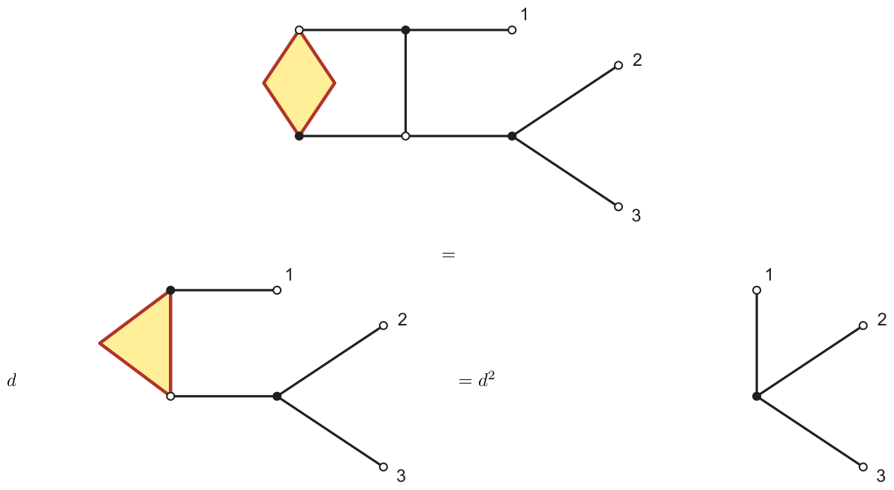
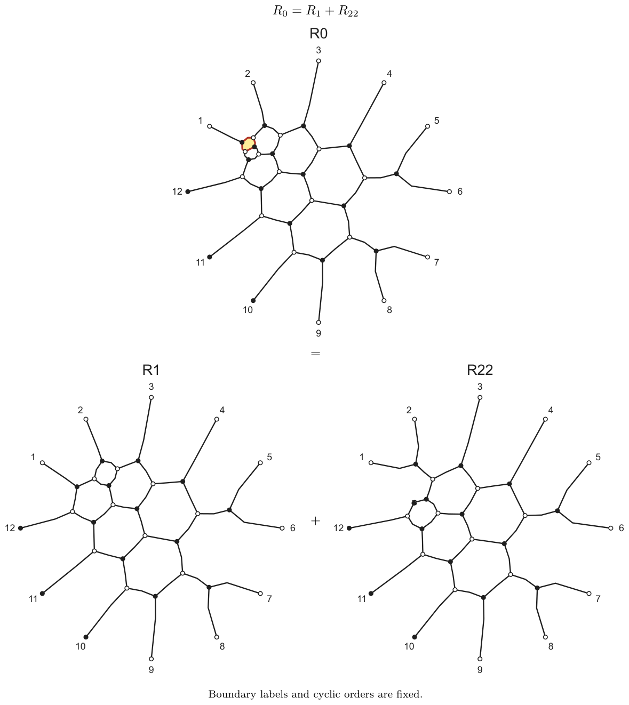
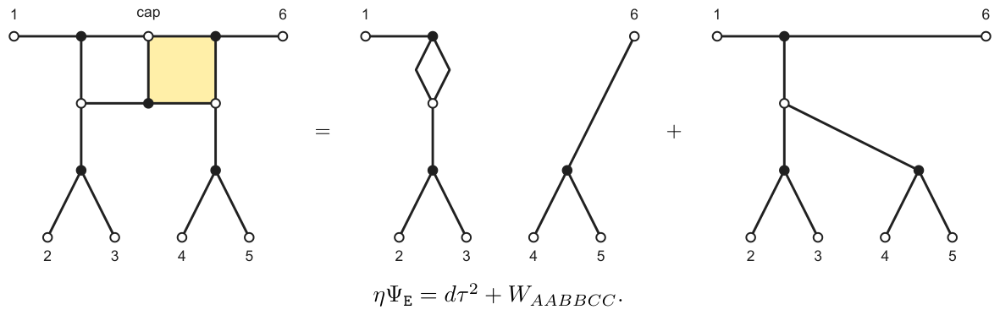

# 7. Canonicality from local degree bounds

[Section index](README.md) · [Complete paper](../paper.md) · [AI reading guide](../../AI_README.md)

By [Proposition 3D.2](03.md#thm:canonical), we must show that $\beta_m$ is bar invariant
and congruent to $e_{c_m}$ modulo $v$ in the standard tensor lattice.
The main work is to control the degrees of all tensor coordinates
at once.

We change coordinates on $\mathcal E$ to replace the prefix $\mathsf{p}$,
block $T$ and tail $\boldsymbol{\rho}$ by $\widehat p,\widehat T,\widehat\rho$,
defined in [Section 7B](#loc:gauge). The final tensor is unchanged:

$$
\widehat p\,\widehat T^{\,m}\widehat\rho=\mathsf{p} T^m\boldsymbol{\rho}=\beta_m.
$$

We will show that these transformed maps have coefficients in $R=\mathbb{Z}[v]$.
In degree zero, $\widehat\rho$ gives $AAA\otimes e_{\mathtt{E}}$,
each $\widehat T$ preserves $AAA$ and adds $\mathtt{M}$, and
$\widehat p$ replaces $AAA$ by $\mathtt{S}$. Composing these terms gives
$e_{c_m}$ for every $m$.

### 7A. The local paths

We begin with the degree estimates for the small pieces of a block.
For the local bounds here and in [Section 8](08.md#sec:readout), degree means
degree in ${v^{-1}}$. In particular,

$$
\deg_{{v^{-1}}}(v^k)=-k,\qquad \deg_{{v^{-1}}}0=-\infty.
$$

An integral Laurent polynomial lies in $R$ exactly when its degree
is at most zero; it lies in $v R$ when that degree is strictly negative.
For a map with entries in $R$, write $M[0]$ for its matrix of constant coefficients.

Words in the local tables abbreviate standard tensors. We also write
$|s\rangle=e_s$ and use $\langle s|$ for the corresponding coordinate
functional, and $[a<b]=\delta_{a<b}$ for indicators.

Keep $\mathsf R_i=H_{i+1}Y_i$ and $\mathsf S=H_2H_1Y_0$ from
[Section 6A](06.md#sec:localmaps), and put $\mathsf L_i=H_iY_{i+1}$.
We also use these growth abbreviations for their upward tensor maps;
then $Y_i$ is a split and $a_i$ is a cup. A path 
chooses one monomial from each local coefficient; its
degree is the sum of their degrees. The elementary tables show that
all coefficients of an individual web are nonnegative and that the
only branch of positive ${v^{-1}}$-degree of $H$ is $AC\mapsto v^{-1} AC$.
Thus the degree of a nonzero web coordinate is the largest
degree of its compatible paths.

**Lemma 7A.1.** Every path through $y$, a cup, $\mathsf R_i$, or $\mathsf L_i$ has degree at most
zero. In $\mathsf S$, the only path of positive ${v^{-1}}$-degree is

$$
ABC\xrightarrow{Y_0,0}ABBC
 \xrightarrow{H_1,0}ACAC\xrightarrow{H_2,1}ACAC.
$$

Its degree and multiplicity are one. Furthermore

**Equation 7A.2.**

$$
\langle ACAC|\mathsf S=v^{-1}\langle ABC|+\langle ACB|+\langle BAC|,
 \qquad \mathsf S(AAA)=AAAB+v BAAA.
$$

*Proof.* 
The assertions for $y$ and a cup follow from their tables. In
$\mathsf R$, a degree-one branch of $H$ requires the right output of
the preceding $y$ to be $A$. That branch of $y$ has degree $-1$, so
the total is at most zero. In $\mathsf L$, the same argument uses the
left output $C$ of $y$.

A path of positive degree through $\mathsf S$ must use the degree-one term
of the last $H$ and a degree-zero path through the preceding
$\mathsf R$. Thus the first $H$ must output $A$ on its right.
The possibilities are $AA\to AA$, $AB\to BA$, $BB\to CA$ and
$CA\to CA$. The first two require a preceding split of degree $-1$;
the last already has degree $-1$. Hence only $BB\to CA$ remains.
Its preceding split is $A\to AB$, and the last $H$ forces the third
input to be $C$. This is the displayed path.

For output $ACAC$, the complete three paths are

$$
\begin{array}{c|ccc|r}
 &\text{after }Y_0&\text{after }H_1&\text{after }H_2&\deg_{{v^{-1}}}\\\hline
ABC&ABBC&ACAC&ACAC&1\\
ACB&ABCB&ACBB&ACAC&0\\
BAC&ACAC&ACAC&ACAC&0
\end{array}.
$$

They exhaust the choices in the $H$ table. The formula at $AAA$
follows by applying that table to the two terms of $y(A)$. ∎

In the notation above, the block in [Equation 6A.1](06.md#eq:growth) has downward string
$\Psi_{\mathtt M}:Y_2Y_6Y_7\mathsf R_1\mathsf S \mathsf R_2\mathsf L_3\mathsf R_1\mathsf S$.
The only possible degree increases in $\Psi_{\mathtt M}$ therefore come from its two
occurrences of $\mathsf S$. To study the part between them, put

$$
X_4=V^-\otimes V^+\otimes V^+\otimes V^-,\qquad
X_7=V^{---+--+},\qquad X_8=V^{+--++--+}.
$$

Here $V^S$ denotes the signed tensor product defined in
[Section 3](03.md#sec:webs).
Let $M_{\mathrm{loc}}:X_4\to X_7$ have downward string
$\mathsf R_2\mathsf L_3\mathsf R_1$, and set

$$
N_{\mathrm{loc}}=(\mathsf S\otimes I_{V^{+--+}})
M_{\mathrm{loc}}\mathsf S:V^{\otimes3}\to X_8.
$$

The rightmost $\mathsf S$ has positive inputs and the leftmost has
negative inputs. The map $O:X_8\to V^{\otimes12}$ already defined in
[Section 6A](06.md#sec:localmaps) has string $Y_2Y_6Y_7\mathsf R_1$.
Expanding the growth strings gives
$\Psi_{\mathtt M}=ON_{\mathrm{loc}}$ and $\Psi_{+}=O\kappa_8$. This factorization lets us locate
the term canceled by the correction $\Psi_{+}$.

### 7B. An integral coordinate system

The block $T$ has some positive ${v^{-1}}$-degrees, so reducing it
modulo $v$ is not yet possible. We change coordinates on $\mathcal E$
so that the prefix $\mathsf{p}$, block $T$ and tail $\boldsymbol{\rho}$ become maps
$\widehat p,\widehat T,\widehat\rho$ with entries in $R$.

For a three-letter state $s$, define

$$
h_s=[s\in\{ABC,ACB,BAC\}],\quad
\Delta=\operatorname{diag}(v^{-h_s}),\quad
\mathsf J=\begin{pmatrix}I&0\\-v\eta&1\end{pmatrix},\quad
G=\operatorname{diag}(\Delta,-1)\mathsf J.
$$

Put $\widehat T=(G\otimes I_9)TG^{-1}$,
$\widehat p=\mathsf{p} G^{-1}$, and
$\widehat\rho=(G\otimes I_6)\boldsymbol{\rho}$.
With the identity maps on exterior strands understood, adjacent factors
$G^{-1}G$ cancel in $\widehat p\,\widehat T^{\,m}\widehat\rho$, giving $\beta_m$ as above.
We use $G$ only to estimate coordinates.

Here is the reason for the choice of $G$. The map $N_{\mathrm{loc}}$
has one degree-two term, at input $ABC$ and output $(AC)^4$.
The tensor $\kappa_8$ has coefficient $1$ at $(AC)^4$, and
$\eta(ABC)=v^{-3}$. Hence $v\kappa_8\eta$ has exactly the same degree-two
term. The triangular matrix $\mathsf J$ introduces this cancellation, while
$\Delta$ rescales the three states $ABC,ACB,BAC$ to compensate for
the remaining positive degrees. Negating the scalar 
coordinate makes the two constant transitions in
[Section 8](08.md#sec:readout) positive.

**Lemma 7B.1.** Every coefficient of $(\Delta\otimes I_9)O$ belongs to $R$.

*Proof.* 
Only the first three output letters determine the shift $h_s$.
The two splits at positions six and seven have nonpositive degree
and do not affect those letters.
The relevant local piece is $\mathsf R$ followed by $y$ on its second
output, with an unchanged letter $a$ on the left. Write the first three
final letters as $apr$. If this is $ABC$ or $BAC$, then $r=C$ is the
left output of $y$, forcing degree $-1$ at that $y$;
the preceding $\mathsf R$ has degree at most zero by
[Lemma 7A.1](#loc:nonpositive). If it is $ACB$,
then $p=C$ forces degree $-1$ at the first $y$ inside $\mathsf R$.
An $H$ of degree one could cancel this only via $AC\to AC$;
the last $y$ then has input $A$, and producing $r=B$ forces its
degree $-1$ branch. Thus every output with $h_s=1$ has degree at most $-1$ before
rescaling. For outputs with $h_s=0$, [Lemma 7A.1](#loc:nonpositive)
applies directly. ∎

**Lemma 7B.2.** The only monomial of $N_{\mathrm{loc}}$ with degree exceeding $h_s$ at input $s$
is

$$
v^{-2}\,|ACACACAC\rangle\langle ABC|,
$$

with coefficient one.

*Proof.* 
Work backwards along a degree-zero path through $M_{\mathrm{loc}}$
whose output starts with $ABC$. This forces

**Equation 7B.3.**

$$
ACAC\xrightarrow{\mathsf R_1}ABBBC
\xrightarrow{\mathsf L_3}ABBCAC
\xrightarrow{\mathsf R_2}ABCACAC.
$$

Indeed, the last $\mathsf R$ must have its first output $C$. Its $y$ has
degree $-1$ and its $H$ must be $AC\to v^{-1} AC$, forcing input $BC$
and output $CAC$. The preceding $\mathsf L$ must have first output $C$;
in degree zero this forces input $BC$, $y(C)=BC$ and $H(BB)=CA$,
again giving $CAC$. The first $\mathsf R$ must now output $BBB$;
its only degree-zero route starts at $CA$ and uses $y(C)=BC$,
$H(CA)=BB$. The unchanged first letter is $A$.

Both copies of $\mathsf S$ have degree at most one. A degree-two path
must use their positive branches and the degree-zero middle path,
which gives exactly the stated term. For $s\notin\{ABC,ACB,BAC\}$,
a positive path would have to use degree zero in the first $\mathsf S$
and in $M_{\mathrm{loc}}$, followed by the positive second $\mathsf S$.
[Equation 7B.3](#loc:middlepath) then requires the first $\mathsf S$ to end at
$ACAC$ in degree zero, excluded by [Equation 7A.2](#loc:Srow). For $ACB,BAC$, a degree-one term does not exceed $h_s$. For $ABC$,
only degree two exceeds $h_s$. These cases cover all input states. ∎

**Lemma 7B.4.** Every entry of

$$
\bigl(\Delta(\Psi_{\mathtt M}-v\Psi_{+}\eta)\Delta^{-1},\Delta \Psi_{+}\bigr)
$$

belongs to $R$.

*Proof.* 
The unique constant monomial of the four-cup tensor $\kappa_8$ is
$(AC)^4$. On a permutation $s$ of $ABC$, the tripod evaluation $\eta$ has coefficient
$v^{\operatorname{inv}(s)-3}$. The largest degree of $v\kappa_8\eta$ at input $s$ is
$2-\operatorname{inv}(s)$, which is at most $h_s$ except at $s=ABC$.
There its unique degree-two monomial is precisely the one in
[Lemma 7B.2](#loc:offender). Thus

$$
(N_{\mathrm{loc}}-v\kappa_8\eta)\Delta^{-1}\in\operatorname{Mat}(R).
$$

The coefficient of the canceled term is $1$ in both maps. Since
$\Psi_{\mathtt M}=ON_{\mathrm{loc}}$, $\Psi_{+}=O \kappa_8$, and $\Delta O$ has entries in $R$
by [Lemma 7B.1](#loc:outer), multiplication proves both assertions. ∎

### 7C. The lower row and a capping identity

We next estimate the lower row of $\widehat T$. For this we use a
web identity obtained by capping the first three outputs of $\Psi_{\mathtt M}$. Its square resolutions produce $d\Psi_{-}$ and eleven further
web maps. Define their sum by $\mathcal H=\sum_{j=1}^{11}\mathcal H_j$, where
$\mathcal H_j=P_j'h_j'$ and $P_j'$ has nine positive outputs. As in the table
for $\Psi_{-}$, the last column gives the input signs of the prefix map.

|  | Downward string for $P_j'$ | $h_j'$ | Input of $P_j'$ |
| --- | --- | --- | --- |
| $\mathcal H_1$ | $Y_1Y_3Y_4a_4\mathsf R_1$ | $I$ | $+++$ |
| $\mathcal H_2$ | $Y_1Y_3Y_4Y_3Y_2Y_1$ | $I$ | $+++$ |
| $\mathcal H_3$ | $Y_1Y_2a_2Y_2Y_1Y_1$ | $\lambda_2$ | $+-$ |
| $\mathcal H_4$ | $Y_1Y_3Y_4\mathsf R_0Y_1\mathsf R_0Y_1$ | $\lambda_2E_1$ | $+-$ |
| $\mathcal H_5$ | $Y_1a_1Y_1Y_2Y_1Y_1$ | $\lambda_2$ | $+-$ |
| $\mathcal H_6$ | $Y_0Y_3Y_4Y_3Y_3\mathsf S$ | $I$ | $+++$ |
| $\mathcal H_7$ | $Y_0Y_2a_2Y_2a_2$ | $\lambda_1E_2$ | $-+$ |
| $\mathcal H_8$ | $Y_0Y_2a_2Y_2\mathsf R_0$ | $I$ | $+++$ |
| $\mathcal H_9$ | $Y_0Y_1Y_2Y_1Y_2a_2$ | $\lambda_1$ | $-+$ |
| $\mathcal H_{10}$ | $Y_0Y_1Y_2Y_1Y_2\mathsf R_0Y_1$ | $\lambda_2$ | $+-$ |
| $\mathcal H_{11}$ | $Y_0Y_1Y_2Y_1Y_1a_1$ | $\lambda_1$ | $-+$ |

The last row of the table for $\Psi_{-}$ gives $D_8=\tau^3\eta$.
Set $D_0=\Psi_{-}-D_8$, and write
$\operatorname{asc}(abc)=[a<b]+[b<c]$ for the number of adjacent
ascents in a three-letter input. We first bound the degrees of
$D_0$ and $\mathcal H$, then prove the capping identities.

**Lemma 7C.1.** At every exterior state $\omega$ and input $s$,

$$
\deg_{{v^{-1}}}(D_0)_{\omega,s},\ \deg_{{v^{-1}}}\mathcal H_{\omega,s}\le\operatorname{asc}(s)\le1+h_s.
$$

*Proof.* 
Except for $P_1$ in $D_1$ and $P_6'$ in $\mathcal H_6$, all prefix strings
use only nonpositive $y$, cup, and $\mathsf R$ pieces. In those two
exceptions, $\mathsf S$ acts first on the original three-strand input and
the remaining pieces are nonpositive; their bound is $[s=ABC]$.
Their attached maps $h_1$ and $h'_6$ are identities, so this bound
is at most $\operatorname{asc}(s)$.

It remains to bound the small maps attached to the nonpositive
prefixes. The maps $I,\lambda_1,\lambda_2$ have degree at most
$\operatorname{asc}(abc)$ from [Equation 3C.1](03.md#eq:localmaps). For $\lambda_2E_1$, when $a\ne b$,
the two possible degrees are

$$
\epsilon(a,b)+[b<c],\qquad [a<c],\quad
\epsilon(a,b)=\begin{cases}1&a<b,\\-1&a>b.\end{cases}
$$

The first is at most $\operatorname{asc}(abc)$; the second is too, since no adjacent
ascent implies $a\ge b\ge c$. When $a=b$, the map is zero.
For $\lambda_1E_2$ the degrees are $[a<b]+\epsilon(b,c)$ and $[a<c]$,
with the same proof. Composition and summation preserve the bounds.
Finally, two strict ascents force $s=ABC$, so $\operatorname{asc}(s)\le1+h_s$. ∎

**Lemma 7C.2.** With all boundary positions fixed,

**Equation 7C.3.**

$$
\eta \Psi_{\mathtt M}=d\Psi_{-}+\mathcal H,\qquad \eta \Psi_{+}=d^2\tau^3.
$$

(The equation $\eta \Psi_{+}=d^2\tau^3$ is displayed in [Figure 14](#loc:fun).)

**Figure 14.** The identity $\eta \Psi_{+}=d^2\tau^3$, with the two common
tripods suppressed. The six-output core has string
$Y_0H_0a_1Y_0a_0$. Its first three outputs are capped. Each
highlighted digon removes two vertices and contributes $d$. [Diagram description](../diagrams.md#figure-14).

*Proof.* 
For the first identity, cap the first three outputs of $\Psi_{\mathtt M}$.
Resolve the indicated square in [Figure 15](#loc:firstsquare). Its branches
are $R_1$ and $R_{22}$. A digon removal in the second branch gives
$R_{22}=dR_{23}$. The complete square-reduction tree is

$$
\begin{array}{rcl@{\qquad}rcl}
R_1&=&R_2+R_{11}&R_{23}&=&R_{24}+R_{31}\\
R_2&=&R_3+\mathcal H_4&R_{24}&=&R_{25}+D_4\\
R_3&=&R_4+R_7&R_{25}&=&R_{26}+D_6\\
R_4&=&\mathcal H_3+\mathcal H_5&R_{26}&=&D_8+D_7\\
R_7&=&\mathcal H_2+\mathcal H_1&R_{31}&=&R_{32}+R_{35}\\
R_{11}&=&R_{12}+R_{17}&R_{32}&=&D_3+D_5\\
R_{12}&=&R_{13}+\mathcal H_{10}&R_{35}&=&D_2+D_1\\
R_{13}&=&\mathcal H_{11}+\mathcal H_9&&&\\
R_{17}&=&R_{18}+\mathcal H_6&&&\\
R_{18}&=&\mathcal H_7+\mathcal H_8.&&&
\end{array}
$$

[Appendix B](appendix-b.md#loc:atlasappendix) displays every local relation and every
terminal beside the corresponding defining map. Each square has
coefficient one in both resolutions. Summing the left column gives
$\mathcal H$, and summing the right column gives $\Psi_{-}$.

The morphism $\Psi_{+}$ consists of its core with six boundary vertices, with leading word
$ABACBC$, followed by two tripods; this follows by reading its
displayed growth string. Capping the first three legs of that core
exposes a digon and then a second digon. Their removals leave a tripod.
The other two tripods are unchanged, giving the second identity. ∎

**Figure 15.** First square in $\eta \Psi_{\mathtt M}$. Boundary $1,\ldots,9$ consists of
the outputs; $12,11,10$ are the inputs in their linear order.
Hollow vertices are sources and filled vertices are sinks, as in
[Figure 3](03.md#fig:relations).
The highlighted face is replaced by its two non-crossing smoothings.
Subsequent relations are included in [Appendix B](appendix-b.md#loc:atlasappendix). [Diagram description](../diagrams.md#figure-15).

**Lemma 7C.4.** Every entry in the lower row of $\widehat T$ belongs to $R$.
Its constant column at input $AAA$ is zero.

*Proof.* 
Multiplying $(G\otimes I_9)TG^{-1}$, its lower row is

$$
\left(
\bigl(v\eta \Psi_{\mathtt M}-\Psi_{-}-v(v\eta \Psi_{+}-d\tau^3)\eta\bigr)\Delta^{-1},
v\eta \Psi_{+}-d\tau^3
\right).
$$

Now use [Equation 7C.3](#loc:openidentities), $v d-1=v^2$ and
$\Psi_{-}=D_0+\tau^3\eta$. The lower row becomes

**Equation 7C.5.**

$$
\left((v^2D_0+v\mathcal H-v^4\tau^3\eta)\Delta^{-1},v^2d\tau^3\right).
$$

After the input shift $-h_s$, the first two terms have degrees
at most $-1$ and $0$, respectively,
by [Lemma 7C.1](#loc:ascent). The term containing $\eta$ has degree at most $-2$: its evaluation degrees on $ABC,ACB,BAC,BCA,CAB,CBA$ are $3,2,2,1,1,0$, and the shift is $-4-h_s$. The last term has degree at most $-1$.
At input $AAA$, $\operatorname{asc}(AAA)=0$ and $\eta(AAA)=0$, so the first two terms have
degrees at most $-2$ and $-1$. Thus that column has zero constant. ∎

### 7D. The constant state and the two ends

Both rows of $\widehat T$ now have entries in $R$. To identify its
constant action, we need only the input state $AAA$. The following
three lemmas track it through the block, prefix and tail.

**Lemma 7D.1.** The constant part of $\widehat T$ at input $AAA$ is exactly
$AAA\otimes e_{\mathtt{M}}$, with coefficient one.

*Proof.* 
The tripod evaluation $\eta$ vanishes at $AAA$, so there is no
upper-row correction.
By [Equation 7A.2](#loc:Srow), $\mathsf S(AAA)=AAAB+v BAAA$.
A degree increase at the second $\mathsf S$ requires the middle
map to output a word beginning with $ABC$. The map
$M_{\mathrm{loc}}$ fixes the first letter, so this is impossible
from $BAAA$. From $AAAB$, producing the second letter $B$ forces
the first $\mathsf R$, at input $AA$, to use its degree $-1$
output $BAA$. The first input of the last $\mathsf R$ is then $A$,
whose split cannot have first output $C$. Thus the second
$\mathsf S$ cannot increase the degree.

Only the $AAAB$ term can contribute degree zero. The unique
degree-zero branches of $\mathsf R$ at $AA$ and $\mathsf L$ at $BB$ force

$$
M_{\mathrm{loc}}(AAAB)[0]=AAAABBC,\qquad N_{\mathrm{loc}}(AAA)[0]=AAABABBC.
$$

All other terms have negative degree and remain negative under
$\Delta O$ by [Lemma 7B.1](#loc:outer). On the remaining term, the upward
operations $\mathsf R_1,Y_7,Y_6,Y_2$ give the sole constant path

$$
\begin{aligned}
AAABABBC&\to AAABBABBC\to AAABBABACC\\
&\to AAABBAACACC\to AAABBBAACACC=AAA\,\mathtt{M}.
\end{aligned}
$$

Other branches here have first three letters among $AAA,AAB,ABA,ABB$.
They all have $h_s=0$, so the rescaling adds no further constant term.
The lower-row assertion is [Lemma 7C.4](#loc:lowerrow). ∎

**Lemma 7D.2.** The coefficients of $\widehat p$ belong to $R$, and
$\widehat p[0](AAA)=e_{\mathtt{S}}$.

*Proof.* 
Since the scalar entry of $\mathsf{p}$ is zero,
$\widehat p=(\Psi_{\mathtt S}\Delta^{-1},0)$. In $\Psi_{\mathtt S}=Y_0Y_3\mathsf S$, the two $Y$'s
are nonpositive and [Lemma 7A.1](#loc:nonpositive) gives

$$
\deg_{{v^{-1}}} (\Psi_{\mathtt S})_{w,s}\le[s=ABC]\le h_s.
$$

For $AAA$, the constant path is
$AAA\to AAAB\to AAAAC\to ABAAAC$; the other branch in
[Equation 7A.2](#loc:Srow) has negative degree and stays negative through the remaining splits. ∎

**Lemma 7D.3.** All coefficients of $\widehat\rho$ belong to $R$, and

$$
\widehat\rho[0]=AAA\otimes e_{\mathtt{E}}.
$$

*Proof.* 
Cap the first three outputs of $\Psi_{\mathtt E}$ with $\eta$.
A square resolution and a digon removal give the relation in
[Figure 16](#fig:moresquares):

**Equation 7D.4.**

$$
\eta \Psi_{\mathtt E}=d\tau^2+W_{AABBCC}.
$$

**Figure 16.** The terminal square relation [Equation 7D.4](#loc:tailidentity). The second
branch is the tree with word $AABBCC$; the first becomes two tripods
after one digon removal. Boundary positions are fixed. [Diagram description](../diagrams.md#figure-16).

The tree has downward string
$Y_1Y_2Y_1Y_0a_0$. Thus

$$
\widehat\rho=\binom{\Delta \Psi_{\mathtt E}}{v^2\tau^2+v W_{AABBCC}}.
$$

The scalar entry is strictly negative in ${v^{-1}}$-degree. The tree and
$\tau^2$ contain only nonpositive $Y$ and cup factors.

The upward tail string is $a_0,Y_0,Y_1,Y_2,Y_1,Y_2,Y_3,Y_2$.
It has one degree-zero path and eight paths of degree $-1$: choose
one $-1$ branch and zero branches elsewhere. They give

$$
\begin{array}{c|l}
\text{changed upward step}&\text{complete output word}\\\hline
\text{none}&AAABBCBCC\\
0&AAACBCBCB\\
1&BAABBCACC\\
2&ABACBCABC\\
3&AAABBCCBC\\
4&ABABACBCC\\
5&AABCABBCC\\
6&AAABCBBCC\\
7&AABABCBCC.
\end{array}
$$

None starts with $ABC,ACB,BAC$. The coordinates with these first
three letters therefore have degree at most $-2$ before the shift
by $\Delta$, and remain strictly negative afterwards. All other
coordinates are unshifted. This leaves the single constant state
$AAA\,\mathtt{E}$. ∎

### 7E. Identifying the dual canonical vector

We have the following.

**Lemma 7E.1.** For every integer $m\ge0$, the tensor in [Equation 6C.3](06.md#eq:iterate) satisfies

$$
\beta_m=b_{c_m}.
$$

*Proof.* 
The transformed maps have entries in $R$ by
[Lemma 7B.4](#loc:upper), [Lemma 7C.4](#loc:lowerrow), [Lemma 7D.2](#loc:initial)
and [Lemma 7D.3](#loc:terminal). Their constant terms are

$$
\widehat\rho[0]=AAA\otimes e_{\mathtt{E}},\quad
\widehat T[0](AAA)=AAA\otimes e_{\mathtt{M}},\quad
\widehat p[0](AAA)=e_{\mathtt{S}}.
$$

Since the maps have entries in $R$, the constant term of a
composition is the composition of their constant terms.
Only the $AAA$ column of $\widehat T[0]$ is reached in this
induction. Induction therefore gives

$$
\beta_m=\widehat p\,\widehat T^{\,m}\widehat\rho
\equiv e_{\mathtt{S}}\otimes e_{\mathtt{M}}^{\otimes m}\otimes e_{\mathtt{E}}
=e_{c_m}\pmod {v\sum_w R e_w}.
$$

Thus every nonleading tensor coordinate belongs to $v R$.
Give $\mathcal E=V^{\otimes3}\oplus\mathbf{1}$ the componentwise
tensor bar. Each entry in [Equation 6C.2](06.md#eq:maps) is a web map or a sum of
web maps, and the only nonconstant scalar is $-d$, with
$\overline d=d$. By [Lemma 3D.1](03.md#lem:web-bar), the three maps commute
with the corresponding bars, so their composite $\beta_m$ is fixed
by the tensor bar. Together with the congruence above,
[Proposition 3D.2](03.md#thm:canonical) identifies it uniquely with $b_{c_m}$. ∎

We now compute the coordinate required for the KL coefficient.
