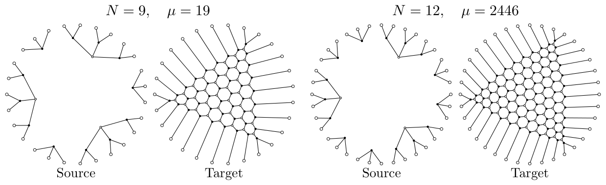
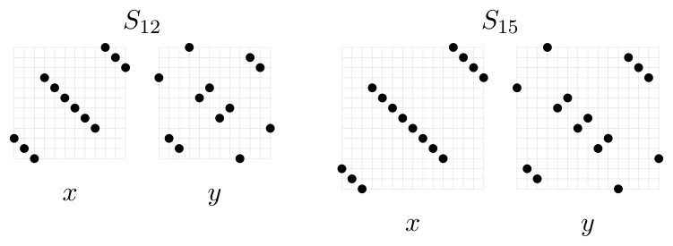
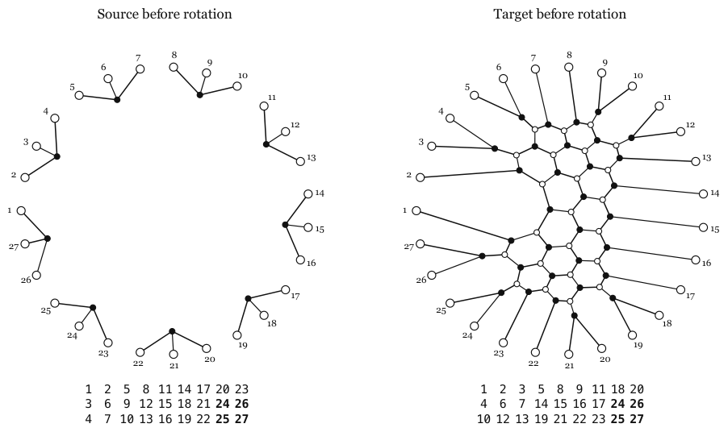
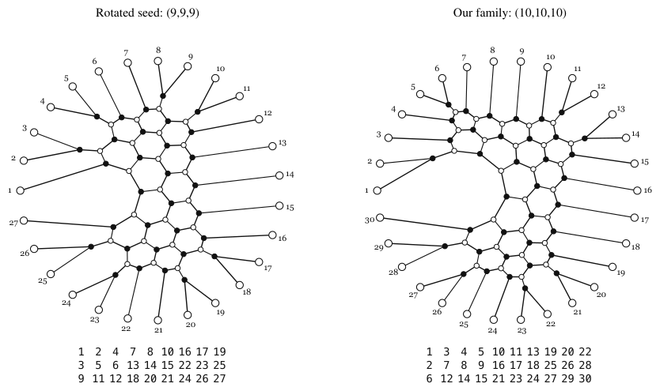

# 9. Methods, AI assistance and AI declaration

[Section index](README.md) · [Complete paper](../paper.md) · [AI reading guide](../../AI_README.md)

We record how we found the family and how we used AI assistance.

### 9A. Human experience (personal account)

One lesson we have learned over our careers is that if things get
bad, they get very bad (see, e.g., \[[BT26](references.md#bib-TorsionProliferation), [K+25](references.md#bib-LinkDetection)\] 
for examples from our works). Looking at Warrington's tables \[[War11](references.md#bib-Warrington)\],
we found it hard to believe that $\mu$-coefficients could be bounded.

Our experience with webs pointed in the same direction. The move
from $\mathfrak{sl}_2$ to $\mathfrak{sl}_3$ is a serious jump: often, $\mathfrak{sl}_2$ is nice, while
$\mathfrak{sl}_3$ seems to contain all the complexity.
And, at least in type A, KL theory and webs are essentially the
same thing. The familiar hexagon-in-hexagons picture in \[[KK99](references.md#bib-KK)\] therefore gave us a natural starting
point. We expected unboundedness to come from pictures of this kind. (The contrast is: 
for $\mathfrak{sl}_2$, the web basis consists of Temperley–Lieb
diagrams without internal faces, and the corresponding
$\mu$-coefficients lie in $\{0,1\}$; even stronger, the corresponding parabolic 
KL polynomials themselves are monomials.)

**Remark 9A.1.** Our intuition that $\mathfrak{sl}_3$ contains all the complexity
goes further. Polo's theorem \[[Pol99](references.md#bib-Polo99)\] says that all polynomials
occur as KL polynomials for symmetric groups, subject to the obvious
restrictions.
We believe that an appropriate version of this statement already
holds for permutations whose RSK shapes have at most three rows.
We also suspect that the largest $\mu$-coefficients in $S_n$ can grow
as fast as $2^{O(n^2)}$, already in three rows
(cf. \[[Lüb20](references.md#bib-Luebeck), Lemma 2.8\]). The family in [Figure 17](#fig:mu19-candidate)
gives $19$ in $S_{27}$ and $2446$ in $S_{36}$ after the canonical
correction. For the computations and two variants, see
`mu19-candidates-and-results.pdf` in our repository \[[G+26b](references.md#bib-GoLaTuVa-mu-code)\].
A second candidate family ([Figure 18](#fig:linear-mu)) would give $\mu=n$
in $S_{3n}$ for every $n\ge4$. Together with the known small examples,
this would realize every nonnegative integer as a $\mu$-coefficient.
For the geometric argument, which we have yet to check, see
`linear_mu_and_webs_summary.pdf` in the same repository.

**Figure 17.** A candidate family of shape $(N,N,N)$; see \[[G+26b](references.md#bib-GoLaTuVa-mu-code)\] for details. [Diagram description](../diagrams.md#figure-17).

**Figure 18.** The first two pairs in the proposed family, with predicted
$\mu$-coefficients $4$ and $5$, respectively. Each dot marks $(i,w(i))$. [Diagram description](../diagrams.md#figure-18).

$x=(3,2,1,9,8,7,6,5,4,12,11,10)$ in $S_{12}$, $y=(9,3,2,12,7,8,5,6,1,11,10,4)$ in $S_{12}$.

$x=(3,2,1,11,10,9,8,7,6,5,4,15,14,13,12)$ in $S_{15}$, $y=(11,3,2,15,9,10,7,8,5,6,1,14,13,12,4)$ in $S_{15}$.

The difficult part was turning that intuition into a proof.
We knew from the start that the necessary calculations would be
very hard by hand, but they seemed amenable to a machine.
That is where AI (mid-2026 models) came in: to help us get the calculations and
details straight, e.g. it found the correct 
family to look at as ours was a bit off.

We now give a few more details.

### 9B. The starting point

We began by computing KL left cell representations with an
implementation of Nguyen's method \[[Ngu20](references.md#bib-Nguyen)\]. We generated the
cell $W$-graphs through $S_{19}$ and for selected larger partitions.
The larger weights led us to three-row tableaux and their webs.
We then looked for a boundary coefficient that we could compute
after correcting a web to its dual canonical vector.

**Remark 9B.1.** Our preliminary computational results were obtained with a Rust program which can be found 
on our associated page \[[G+26b](references.md#bib-GoLaTuVa-mu-code)\].

Our starting example was the following pair of shape $(9,7,7)$,
with computed $W$-graph weight $2$:

$$
S^\circ=\begin{array}{rrrrrrrrr}
1&2&5&8&11&14&17&20&23\\
3&6&9&12&15&18&21&&\\
4&7&10&13&16&19&22&&
\end{array},\qquad
T^\circ=\begin{array}{rrrrrrrrr}
1&2&3&5&8&9&11&18&20\\
4&6&7&14&15&16&17&&\\
10&12&13&19&21&22&23&&
\end{array}.
$$

We completed both tableaux to shape $(9,9,9)$ by adding $24,26$ to
row two and $25,27$ to row three, obtaining $S^+,T^+$, see [Figure 19](#fig:cores1). Deleting the
added entries in reverse order removes the same corner from both
tableaux at each step. By \[[GY22](references.md#bib-GossowYacobi), Proposition 3.3\], this
preserves the symmetrized $\mu$-coefficient, that is, the $W$-graph
weight of the unordered pair.

**Figure 19.** The webs for $S^+,T^+$ and their
tableaux. Bold entries are the four added boxes. [Diagram description](../diagrams.md#figure-19).

Rotate both webs by one boundary position, moving boundary vertex
$1$ to position $27$ and each vertex $i>1$ to position $i-1$.
With the boundary labels fixed, this gives the tableaux
$\operatorname{pr}(S^+),\operatorname{pr}(T^+)$, where
$\operatorname{pr}$ is promotion \[[PPR09](references.md#bib-PPR), Theorem 2.5\].
Simultaneous promotion preserves the symmetrized $\mu$-coefficient
for rectangular tableaux \[[Rho10](references.md#bib-Rhoades), Proposition 3.2\], so the
rotated pair still has $W$-graph weight $2$.

Motivated by the KK counterexample \[[KK99](references.md#bib-KK)\], we
extended the hexagonal strip in the rotated target, with overlap at
boundary positions $13,22,31,\ldots$. This suggested the row words

$$
(ABC)^{6+3k},\qquad R_{\mathrm{seed}}\mathtt{M}^k\mathtt{E},\qquad
R_{\mathrm{seed}}=AABABBAACACC,\quad k\ge0,
$$

with $\mathtt{M},\mathtt{E}$ as in [Equation 2C.7](02.md#eq:words). The case $k=1$ is the promoted pair just described, shown on the
left in [Figure 20](#fig:cores2). We computed its canonical correction, but did not find
a correction that worked for this whole family. We therefore looked
for a simpler start piece.

**Figure 20.** Left: the rotated seed
$R_{\mathrm{seed}}\mathtt{M}\mathtt{E}$. Right: the member $\mathtt{S}\mathtt{M}^2\mathtt{E}$.
Both source webs are products of consecutive tripods. [Diagram description](../diagrams.md#figure-20).

### 9C. Choosing the start piece

Now we explain how the right web in [Figure 20](#fig:cores2) came about.
Robert's red-graph-reductions \[[Rob13](references.md#bib-RobertFamily), [Rob15](references.md#bib-RobertCharacterization)\]
suggested local correction terms. Such a reduction removes edges
bounding selected faces and reconnects the remaining half-edges by
specified pairings, preserving the ordered boundary
\[[Rob15](references.md#bib-RobertCharacterization), Definition 4.1\]. For an exact paired
red graph in a non-elliptic web, the reduced web's projective module
is a direct summand of the original web module
\[[Rob15](references.md#bib-RobertCharacterization), Theorem 3.12 and Proposition 4.4\].

In the seed, the six hexagons surrounding an endpoint hexagon form
such a red graph. Reducing at that end and applying the square and
digon relations suggested the six-letter prefix $\mathtt{S}$. Keeping $\mathtt{M}$
and $\mathtt{E}$ gave the family in [Equation 2C.7](02.md#eq:words). The two families
are compared below; their indices $k$ and $m$ count blocks in their
respective constructions.

| Family | Source word | Target word | Block count |
| --- | --- | --- | --- |
| Seed | $(ABC)^{6+3k}$ | $R_{\mathrm{seed}}\mathtt{M}^k\mathtt{E}$ | $k\ge0$ |
| Theorem | $(ABC)^{4+3m}$ | $\mathtt{S}\mathtt{M}^m\mathtt{E}$ | $m\ge0$ |

See also [Figure 20](#fig:cores2).
Robert's theorem concerns module summands. The values of $\mu$ for
the modified start piece follow from [Section 7](07.md#sec:canonicality) and
[Section 8](08.md#sec:readout). Its base member has $\mu=1$, whereas the
initial seed has $W$-graph weight $2$.

### 9D. From a seed calculation to a uniform argument

For our family with two blocks, the complete canonical
correction has $94$ lower webs, as in [Equation 5C.2](05.md#eq:94correction).
At the selected boundary state, the raw critical coefficient is $18$
and the correction contributes $16$, leaving $2$. Grouping the
correction terms by their behavior across a three-strand cut splits
this calculation into $18-10-6=2$: $\Psi_{\mathtt S}\Psi_{\mathtt M}\Psi_{+}\tau^2$ contributes
$10v$, and $\Psi_{\mathtt S}\Psi_{+}\Psi_{-}\Psi_{\mathtt E}-d\Psi_{\mathtt S}\Psi_{+}\tau^5$ contributes $6v$ to the amount
subtracted. These are the same terms grouped by their web-basis
coefficients as $18-3-13$ in [Section 5](05.md#sec:basischange).

This grouping suggested adding the scalar coordinate to the
three-strand interface in [Section 6](06.md#sec:construction). It allows one
fixed block to incorporate the correction for every $m$.

### 9E. AI assistance and verification

We did the usual back-and-forth dance with AI (classic 2026).
We supplied the computational program, the selected $W$-graph
edges, their web interpretation and the first conjectural family.
We first used AI assistance for figures. Later models accessed
through Claude, ChatGPT and Codex helped with code, the modified
start piece, correction terms, the repeated block, Lean formalization and the proof draft.
AI-assisted symbolic calculations also produced the interface basis
change and the square-reduction tree.

We checked the local formulas by the calculations in the paper and
by independent tensor computations. The code is available in \[[G+26b](references.md#bib-GoLaTuVa-mu-code)\], and the scope of
the Lean formalization is described in [Remark 1E.1](01.md#rem:verification).
We are responsible for the mathematical statements and for verifying
the theoretical and computational inputs.
