

# Appendix B. Details for Lemma 7C.2

[Section index](README.md) · [Complete paper](../paper.md) · [AI reading guide](../../AI_README.md)

The atlas proves $\eta \Psi_{\mathtt M}=d\Psi_{-}+\mathcal H$ from
[Lemma 7C.2](07.md#loc:openidentity). The diagrams $R_i$ form a reduction
tree: at each step we resolve the highlighted square or remove the
highlighted digon. The terminal diagrams are the eight maps $D_i$
and the eleven maps $\mathcal H_j$. The tables below locate each step and
each terminal identification. Each terminal is drawn once, with
its label in the reduction tree and its defining map written above it. The symbols $\mathsf R_i,\mathsf L_i$
in the growth strings denote local operations, whereas $R_i$ denotes
a diagram in this tree.

Boundary labels are fixed. Outputs $1,\ldots,9$ are followed around
the circle by inputs $12,11,10$. Hollow vertices are sources and
filled vertices are sinks. Each square resolution has coefficient
$1$; removing the sole digon contributes $d$.

| Reduction | Figure |
| --- | --- |
| $R_{0}=R_{1}+R_{22}$ | [21](#fig:atlas-r0) |
| $R_{1}=R_{2}+R_{11}$ | [22](#fig:atlas-r1) |
| $R_{2}=R_{3}+R_{10}$ | [23](#fig:atlas-r2) |
| $R_{3}=R_{4}+R_{7}$ | [24](#fig:atlas-r3) |
| $R_{4}=R_{5}+R_{6}$ | [25](#fig:atlas-r4) |
| $R_{7}=R_{8}+R_{9}$ | [26](#fig:atlas-r7) |
| $R_{11}=R_{12}+R_{17}$ | [27](#fig:atlas-r11) |
| $R_{12}=R_{13}+R_{16}$ | [28](#fig:atlas-r12) |
| $R_{13}=R_{14}+R_{15}$ | [29](#fig:atlas-r13) |
| $R_{17}=R_{18}+R_{21}$ | [30](#fig:atlas-r17) |
| $R_{18}=R_{19}+R_{20}$ | [31](#fig:atlas-r18) |
| $R_{22}=dR_{23}$ | [32](#fig:atlas-r22) |
| $R_{23}=R_{24}+R_{31}$ | [33](#fig:atlas-r23) |
| $R_{24}=R_{25}+R_{30}$ | [34](#fig:atlas-r24) |
| $R_{25}=R_{26}+R_{29}$ | [35](#fig:atlas-r25) |
| $R_{26}=R_{27}+R_{28}$ | [36](#fig:atlas-r26) |
| $R_{31}=R_{32}+R_{35}$ | [37](#fig:atlas-r31) |
| $R_{32}=R_{33}+R_{34}$ | [38](#fig:atlas-r32) |
| $R_{35}=R_{36}+R_{37}$ | [39](#fig:atlas-r35) |

| Terminal map | Figure |
| --- | --- |
| $R_{5}=\mathcal H_{3}$ | [41](#fig:atlas-term6) |
| $R_{6}=\mathcal H_{5}$ | [41](#fig:atlas-term7) |
| $R_{8}=\mathcal H_{2}$ | [41](#fig:atlas-term5) |
| $R_{9}=\mathcal H_{1}$ | [41](#fig:atlas-term5) |
| $R_{10}=\mathcal H_{4}$ | [41](#fig:atlas-term6) |
| $R_{14}=\mathcal H_{11}$ | [41](#fig:atlas-term10) |
| $R_{15}=\mathcal H_{9}$ | [41](#fig:atlas-term9) |
| $R_{16}=\mathcal H_{10}$ | [41](#fig:atlas-term9) |
| $R_{19}=\mathcal H_{7}$ | [41](#fig:atlas-term8) |
| $R_{20}=\mathcal H_{8}$ | [41](#fig:atlas-term8) |
| $R_{21}=\mathcal H_{6}$ | [41](#fig:atlas-term7) |
| $R_{27}=D_{8}$ | [40](#fig:atlas-term4) |
| $R_{28}=D_{7}$ | [40](#fig:atlas-term4) |
| $R_{29}=D_{6}$ | [40](#fig:atlas-term3) |
| $R_{30}=D_{4}$ | [40](#fig:atlas-term2) |
| $R_{33}=D_{3}$ | [40](#fig:atlas-term2) |
| $R_{34}=D_{5}$ | [40](#fig:atlas-term3) |
| $R_{36}=D_{2}$ | [40](#fig:atlas-term1) |
| $R_{37}=D_{1}$ | [40](#fig:atlas-term1) |

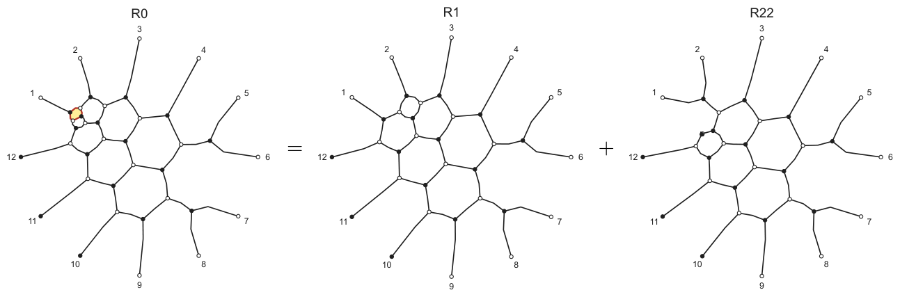

**Figure 21.** Square resolution at $R_{0}$. [Diagram description](../diagrams.md#figure-21).

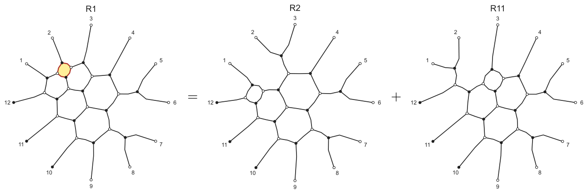

**Figure 22.** Square resolution at $R_{1}$. [Diagram description](../diagrams.md#figure-22).

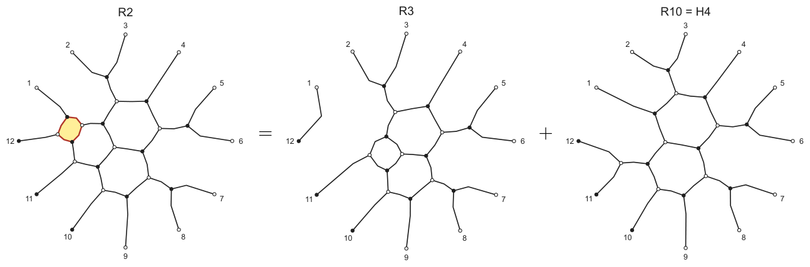

**Figure 23.** Square resolution at $R_{2}$. [Diagram description](../diagrams.md#figure-23).

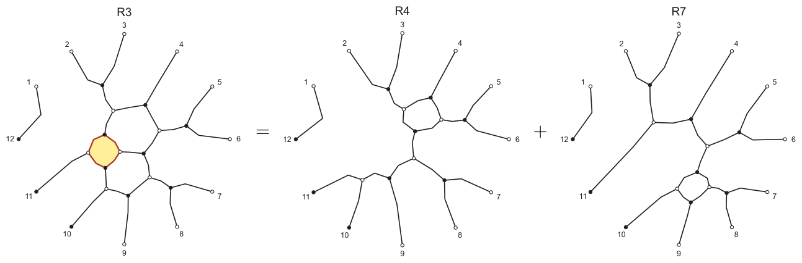

**Figure 24.** Square resolution at $R_{3}$. [Diagram description](../diagrams.md#figure-24).

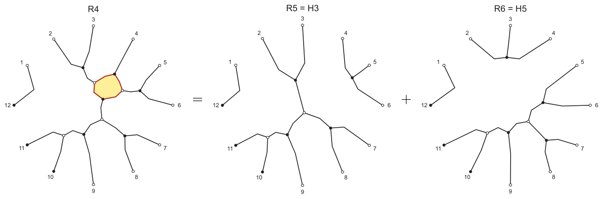

**Figure 25.** Square resolution at $R_{4}$. [Diagram description](../diagrams.md#figure-25).

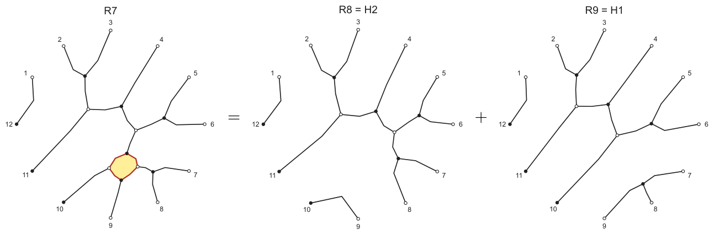

**Figure 26.** Square resolution at $R_{7}$. [Diagram description](../diagrams.md#figure-26).

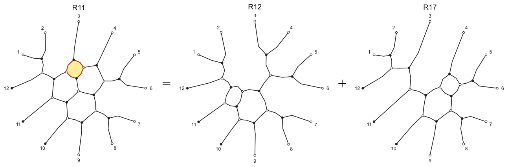

**Figure 27.** Square resolution at $R_{11}$. [Diagram description](../diagrams.md#figure-27).

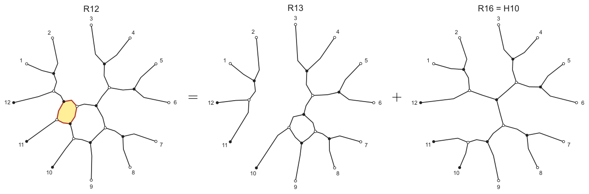

**Figure 28.** Square resolution at $R_{12}$. [Diagram description](../diagrams.md#figure-28).

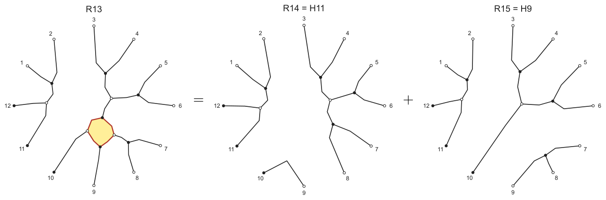

**Figure 29.** Square resolution at $R_{13}$. [Diagram description](../diagrams.md#figure-29).

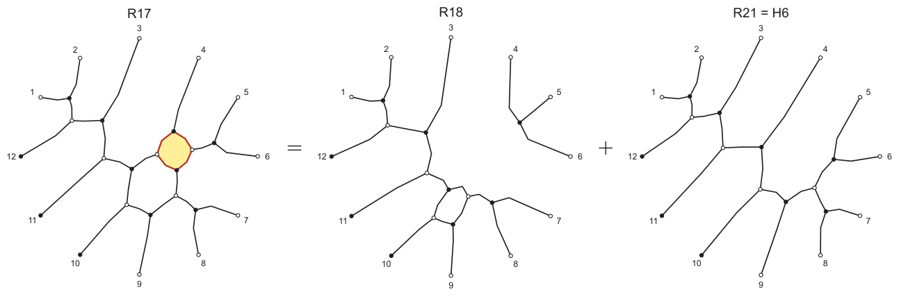

**Figure 30.** Square resolution at $R_{17}$. [Diagram description](../diagrams.md#figure-30).

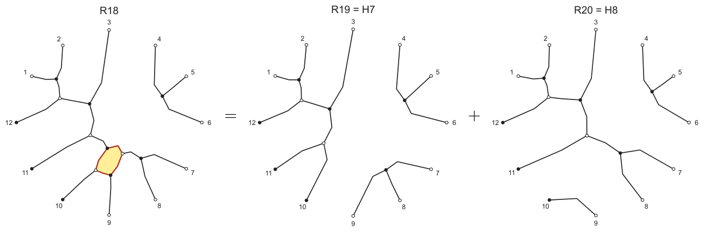

**Figure 31.** Square resolution at $R_{18}$. [Diagram description](../diagrams.md#figure-31).

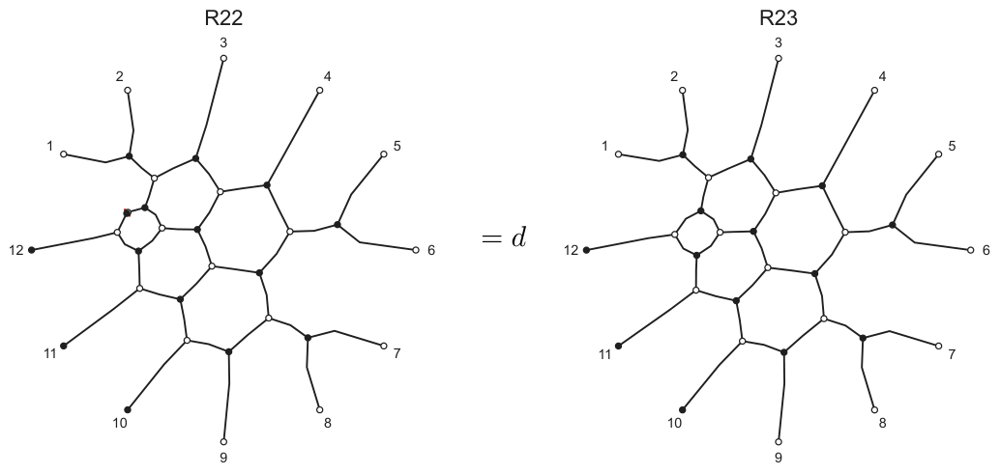

**Figure 32.** Digon removal at $R_{22}$, with coefficient $d$. [Diagram description](../diagrams.md#figure-32).

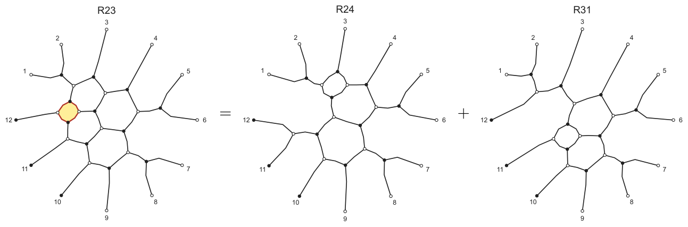

**Figure 33.** Square resolution at $R_{23}$. [Diagram description](../diagrams.md#figure-33).

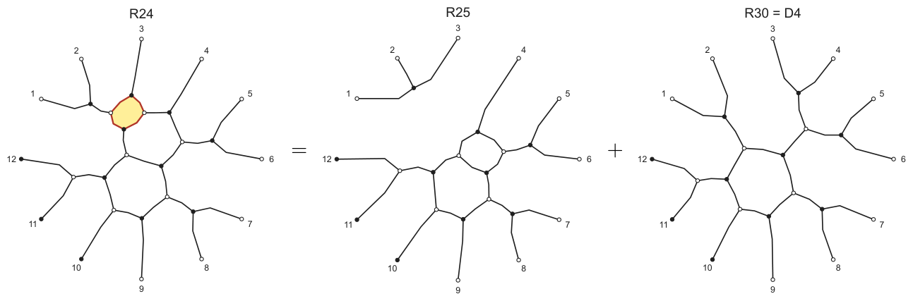

**Figure 34.** Square resolution at $R_{24}$. [Diagram description](../diagrams.md#figure-34).

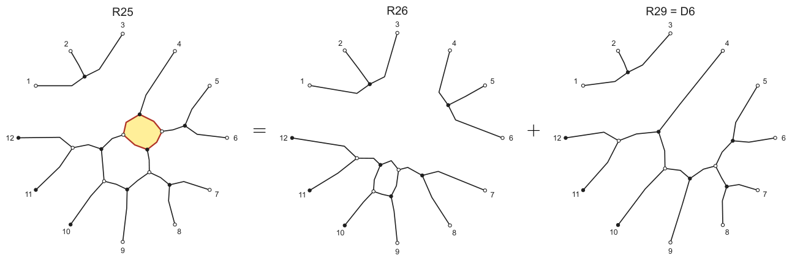

**Figure 35.** Square resolution at $R_{25}$. [Diagram description](../diagrams.md#figure-35).

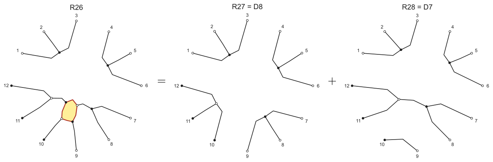

**Figure 36.** Square resolution at $R_{26}$. [Diagram description](../diagrams.md#figure-36).

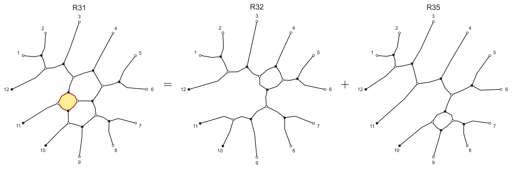

**Figure 37.** Square resolution at $R_{31}$. [Diagram description](../diagrams.md#figure-37).

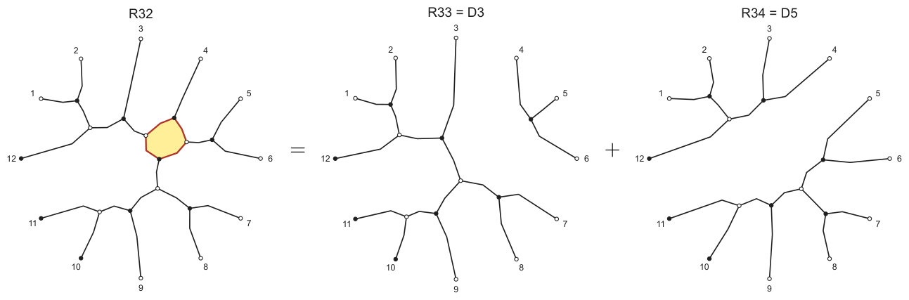

**Figure 38.** Square resolution at $R_{32}$. [Diagram description](../diagrams.md#figure-38).

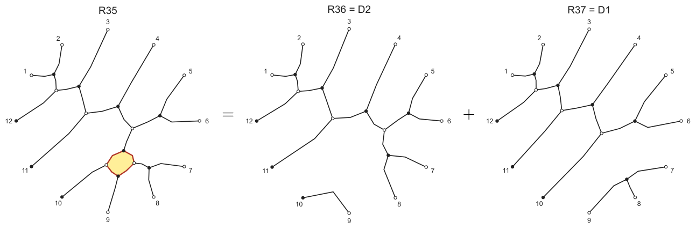

**Figure 39.** Square resolution at $R_{35}$. [Diagram description](../diagrams.md#figure-39).

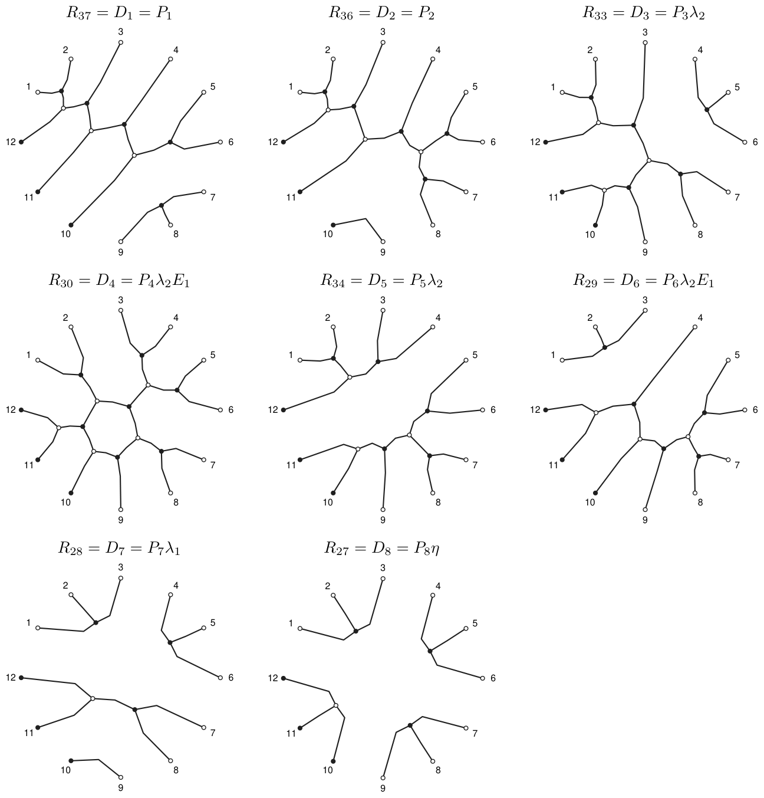

**Figure 40.** The terminal maps $D_1,\ldots,D_8$.
Each diagram shows the full composite $D_i=P_i h_i$.
Outputs are labeled $1,\ldots,9$; the three inputs are labeled
$12,11,10$ in their linear order. [Diagram description](../diagrams.md#figure-40).

The diagram labels are $R_{37}=D_1=P_1$, $R_{36}=D_2=P_2$, $R_{33}=D_3=P_3\lambda_2$, $R_{30}=D_4=P_4\lambda_2E_1$, $R_{34}=D_5=P_5\lambda_2$, $R_{29}=D_6=P_6\lambda_2E_1$, $R_{28}=D_7=P_7\lambda_1$, $R_{27}=D_8=P_8\eta$.

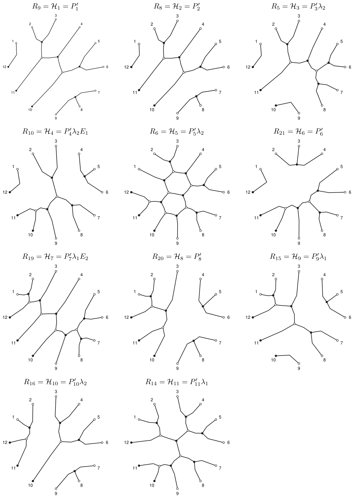

**Figure 41.** The terminal maps $\mathcal H_1,\ldots,\mathcal H_{11}$. [Diagram description](../diagrams.md#figure-41).

The diagram labels are $R_9=\mathcal H_1=P'_1$, $R_8=\mathcal H_2=P'_2$, $R_5=\mathcal H_3=P'_3\lambda_2$, $R_{10}=\mathcal H_4=P'_4\lambda_2E_1$, $R_6=\mathcal H_5=P'_5\lambda_2$, $R_{21}=\mathcal H_6=P'_6$, $R_{19}=\mathcal H_7=P'_7\lambda_1E_2$, $R_{20}=\mathcal H_8=P'_8$, $R_{15}=\mathcal H_9=P'_9\lambda_1$, $R_{16}=\mathcal H_{10}=P'_{10}\lambda_2$, $R_{14}=\mathcal H_{11}=P'_{11}\lambda_1$.
